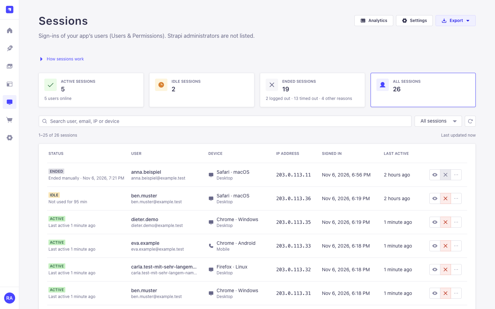
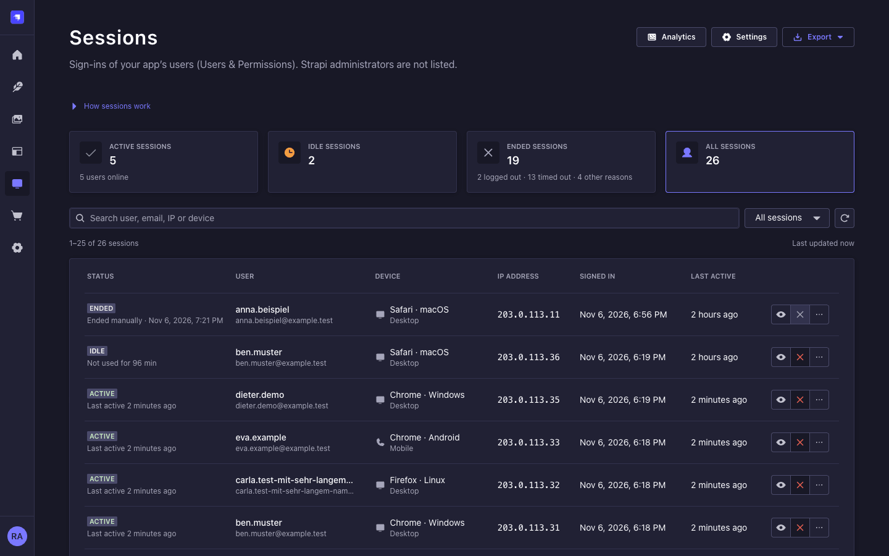
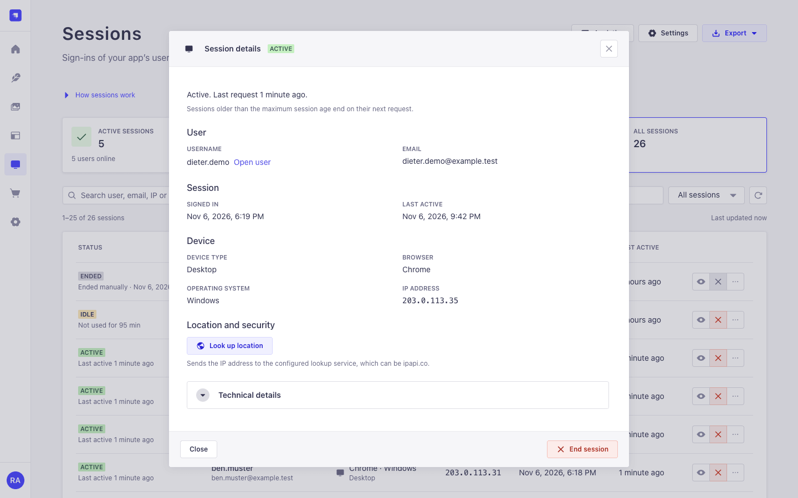
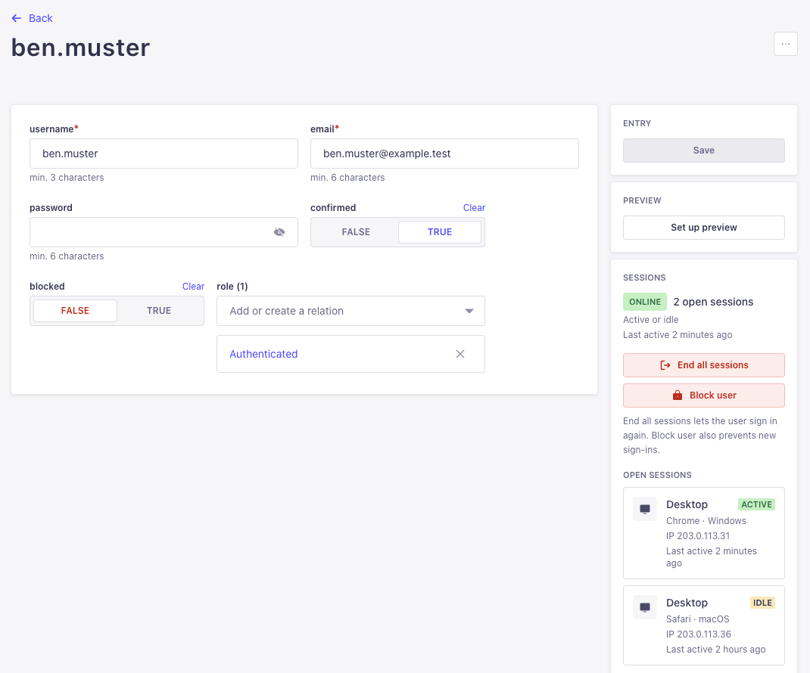
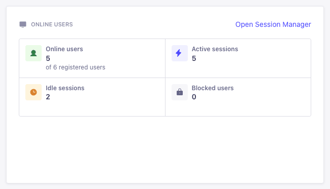
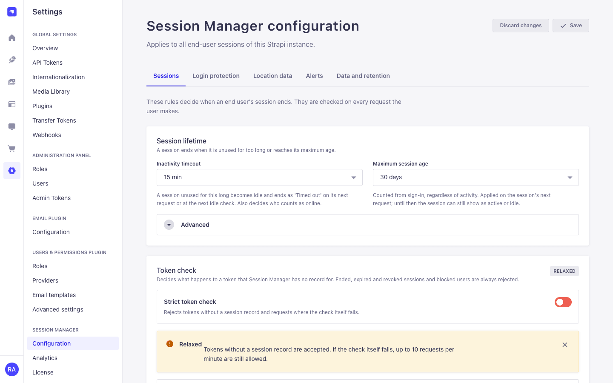
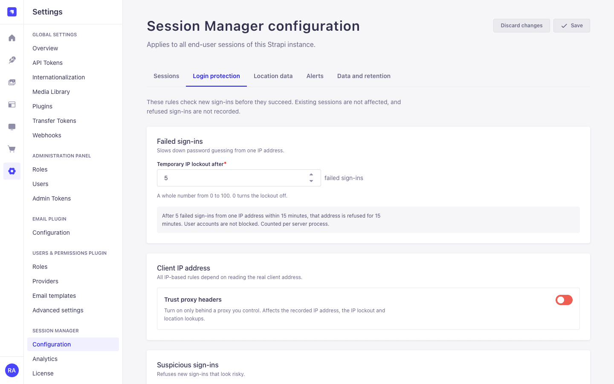
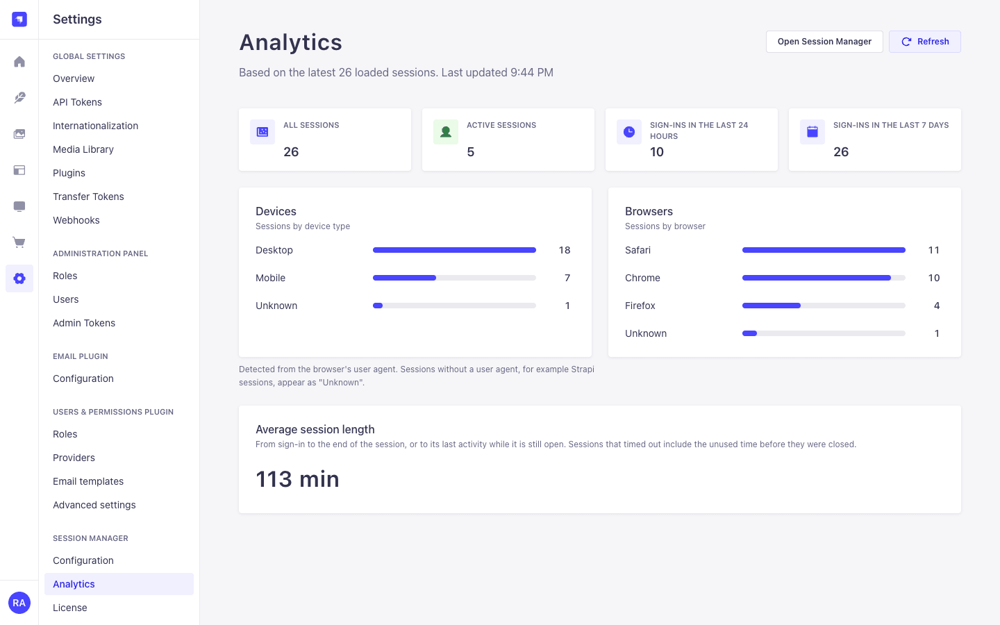
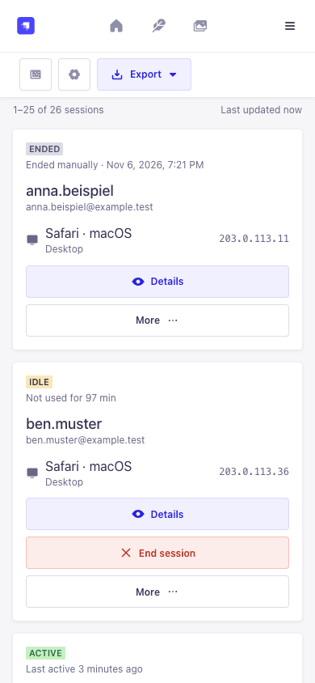
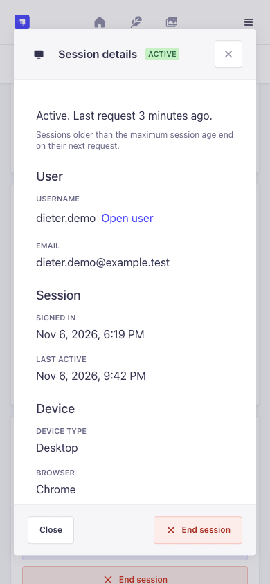

# Magic Session Manager

**See who is signed in to your Strapi 5 app, end any session in one click, and stop password guessing before it reaches your users.**

Magic Session Manager records every sign-in through Users & Permissions as a session. Admins see who is online, end single sessions or all sessions of a user, block accounts and review sign-in history. Your app gets logout routes, a "my devices" list for users, failed-login lockout and optional country rules. It works with Strapi's native refresh-token sessions and with several server processes on one database.

Free and open source under the MIT license. Every feature works without an account, key or activation, and the plugin sends nothing to its author.

[](https://www.npmjs.com/package/strapi-plugin-magic-sessionmanager)
[](https://www.npmjs.com/package/strapi-plugin-magic-sessionmanager)
[](https://github.com/Schero94/Magic-Sessionmanager/actions/workflows/test.yml)
[](LICENSE)

Live docs: [https://schero94.github.io/Magic-Sessionmanager/](https://schero94.github.io/Magic-Sessionmanager/) · [npm](https://www.npmjs.com/package/strapi-plugin-magic-sessionmanager) · [Changelog](CHANGELOG.md) · [Report a bug](https://github.com/Schero94/Magic-Sessionmanager/issues/new/choose) · [Discussions](https://github.com/Schero94/Magic-Sessionmanager/discussions)



---

## Contents

- [Features](#features)
- [Quick start (1 minute)](#quick-start-1-minute)
- [Screenshots](#screenshots)
- [Core concepts](#core-concepts)
- [Screens](#screens)
- [Compatibility](#compatibility)
- [Install](#install)
- [Session management modes](#session-management-modes)
- [Configuration](#configuration)
- [Location data and GeoIP](#location-data-and-geoip)
- [Login protection](#login-protection)
- [Alerts](#alerts)
- [Content API](#content-api)
- [Examples](#examples)
- [Optional route policy: `session-required`](#optional-route-policy-session-required)
- [Admin API and permissions](#admin-api-and-permissions)
- [Running several instances (Railway replicas, pm2 cluster)](#running-several-instances-railway-replicas-pm2-cluster)
- [Performance](#performance)
- [Security and privacy](#security-and-privacy)
- [Troubleshooting](#troubleshooting)
- [FAQ](#faq)
- [Migration and upgrading](#migration-and-upgrading)
- [Development and tests](#development-and-tests)
- [Contributing](#contributing)
- [Maintenance status](#maintenance-status)
- [Languages](#languages)
- [License](#license)

---

## Features

| Area                   | What you get                                                                                                                                                                             |
| ---------------------- | ---------------------------------------------------------------------------------------------------------------------------------------------------------------------------------------- |
| Overview               | A sessions dashboard with Active, Idle and Ended counts, search, filters, CSV and JSON export, and a details dialog per session (device, browser, IP address, location, security score). |
| Control                | End one session, end all sessions of a user, delete a record, or block a user. Ended sessions are rejected on the next request with 401 and a reason header.                             |
| Your users             | Content API routes for "my sessions", "current session", log out, log out everywhere and log out other devices. Each user only ever sees their own sessions.                             |
| Login protection       | Temporary IP lockout after failed sign-ins, Content API rate limits, optional rejection of VPN, proxy or low-score sign-ins, and country allow or block lists.                           |
| Location               | IP location from a local MaxMind GeoLite2 database (no third party in the sign-in path) or from ipapi.co, or turned off.                                                                 |
| Alerts                 | Security emails to the user through Strapi's Email plugin and sign-in notifications to Discord or Slack.                                                                                 |
| Admin integration      | A Sessions panel next to each user in the Content Manager and an Online users widget on the Strapi homepage.                                                                             |
| Native Strapi sessions | Works with `jwtManagement: 'refresh'` (Strapi's own sessions and refresh tokens) and with `'legacy-support'`.                                                                            |
| Several processes      | Lockout, rate limits, jobs and settings stay consistent across pm2 workers and Railway replicas that share one database.                                                                 |
| Privacy                | Stored tokens are encrypted (AES-256-GCM) and never returned. Retention deletes old history automatically. No telemetry.                                                                 |

---

## Quick start (1 minute)

```bash
npm install strapi-plugin-magic-sessionmanager
```

```typescript
// config/plugins.ts
export default () => ({
  'magic-sessionmanager': { enabled: true },
});
```

```bash
# a stable key for token encryption (startup fails without it in production)
echo "SESSION_ENCRYPTION_KEY=$(node -e "console.log(require('crypto').randomBytes(32).toString('base64'))")" >> .env
npm run build && npm run develop
```

Sign in to your app as an end user (`POST /api/auth/local`), open **Session Manager** in the admin menu and the new session is listed as **Active**. End it, and the same token gets 401 on its next request.

Yarn and pnpm work the same way (`yarn add strapi-plugin-magic-sessionmanager`, `pnpm add strapi-plugin-magic-sessionmanager`).

---

## Screenshots

All screenshots use synthetic data: users `*.example.test`, IP addresses from the documentation range `203.0.113.0/24`, Strapi 5.61.

### Sessions dashboard in dark mode



### Session details



### Sessions panel in the Content Manager



### Homepage widget



### Configuration





### Analytics



### Mobile (390 px)

<p>
  
  
</p>

---

## Core concepts

**Session.** One sign-in of a user on one device, from sign-in until it ends. Every session has a **session record** with times, device, IP address and location.

**A session is in one of three states:**

| State      | Meaning                                                                                                                                                  |
| ---------- | -------------------------------------------------------------------------------------------------------------------------------------------------------- |
| **Active** | Open and used within the inactivity timeout.                                                                                                             |
| **Idle**   | Open, but not used for longer than the inactivity timeout. It ends on its next request or at the next idle check. A token refresh makes it active again. |
| **Ended**  | The session can no longer be used. The user has to sign in again on this device.                                                                         |

**An ended session always shows its end reason:**

| End reason          | Stored value | Meaning                                                                                                                                   |
| ------------------- | ------------ | ----------------------------------------------------------------------------------------------------------------------------------------- |
| Logged out          | `logout`     | The user signed out.                                                                                                                      |
| Timed out           | `idle`       | Not used for longer than the inactivity timeout.                                                                                          |
| Expired             | `expired`    | Reached the maximum session age.                                                                                                          |
| Ended manually      | `manual`     | Ended from the Strapi admin, or by the user from another of their devices.                                                                |
| User blocked        | `blocked`    | Ended because the user account was blocked.                                                                                               |
| Reason not recorded | (none)       | No end reason was stored, for example because the session ended in Strapi's own session store or was recorded by an older plugin version. |

**Three verbs, three meanings:**

- **End** a session: it stops working, the record stays in the history.
- **Delete record**: the record is removed from history, statistics and exports. If the session is still open, it also ends. Its token stays revoked.
- **Block** a user: the user cannot sign in, and all open sessions end. **Unblock** allows sign-in again but does not restore ended sessions.

**Online** describes users, never sessions: a user is online when at least one of their sessions is Active. The dashboard, the widget and the user panel all use this one rule, based on the configured inactivity timeout.

---

## Screens

| Where                           | Name                                        | Answers                                                   |
| ------------------------------- | ------------------------------------------- | --------------------------------------------------------- |
| Main menu                       | **Session Manager** (page title "Sessions") | Which sessions exist, and which need action?              |
| Dialog on the dashboard         | **Session details**                         | What is this session, and why is it in this state?        |
| Content Manager, User edit view | **Sessions** panel                          | What access does this user have, and how do I cut it off? |
| Strapi homepage                 | **Online users** widget                     | Who is online right now?                                  |
| Settings › Session Manager      | **Configuration**                           | How should sessions and sign-ins behave?                  |
| Settings › Session Manager      | **Analytics**                               | How are sessions used over time and by device?            |

### Sessions dashboard

- **Header:** title "Sessions", the links **Analytics** and **Settings** (opens Configuration), and **Export** (CSV or JSON of every session that matches the filter, up to 50,000 newest, with an "End reason" column and never any tokens).
- **How sessions work:** a collapsed legend of the three states.
- **Four stat cards** that set the status filter: **Active** ("{n} users online"), **Idle**, **Ended** ("{a} logged out · {b} timed out · {c} other reasons") and **All**.
- **Action bar:** search by user, email, IP or device; **Status** filter (All sessions, Open, Active, Idle, Ended); an **End reason** filter when Ended is selected; Refresh. "Last updated" shows when the list was loaded; it also refreshes every 10 minutes.
- **Table:** Status (badge and a second line, for example "Ended manually · {date}"), User, Device, IP address, Signed in, Last active and the row actions **View details**, **End session** (disabled on ended rows) and **More actions › Delete record**. Clicking a row opens the details.
- Filters, search, page and page size are kept in the URL, so `?search=<email>` is a shareable link.
- Search, filters, sorting and paging run on the server, so the list, the counts and the page numbers cover every session, however many there are. Only the 25 to 100 rows on the screen are loaded.
- In `refresh` mode, open Strapi sessions that have no session details from this plugin (for example sign-ins from before it was installed) are counted in a notice and listed on each user's sessions panel.
- Below the large breakpoint the IP address and Signed in columns are hidden; below the medium breakpoint the table becomes a card list.

### Session details

- A state sentence that explains why the session is in its state, for example "Ended {time} · Ended manually."
- **User** (with an **Open user** link to the Content Manager), **Session** (Signed in, Last active, Ended at, End reason), **Device** (type, browser, operating system, IP address), **Location and security** (country, city, time zone, security score "{score}/100", VPN and proxy).
- **Look up location** for sessions without a stored location. The lookup runs only when you click it, because it can send the IP address to ipapi.co.
- **Technical details** (collapsed): record ID with a copy button and the raw user agent.
- Footer: **End session** with confirmation on open sessions; ended sessions show "This session has already ended."

### Sessions panel (Content Manager)

Shown on the edit view of a Users & Permissions user only.

- **Online** or **Not online**, "{n} open sessions" (active or idle) and the last activity.
- **End all sessions:** signs the user out on every device. The user can sign in again unless the account is blocked.
- **Block user** / **Unblock user:** blocking ends all open sessions and prevents sign-in. The open form's Blocked field is updated, so a later Save does not undo it. Setting the native Blocked field and saving has the same effect.
- Up to five open sessions, then **Show all sessions**, which opens the dashboard filtered by the user's email.
- For an unsaved user the panel only says "Save this user before you can manage sessions."

### Online users widget

Strapi 5.13 and later. Four tiles: **Online users** (of all registered users), **Active sessions**, **Idle sessions** and **Blocked users**, plus a link **Open Session Manager**. The widget refreshes every 30 seconds.

### Settings › Session Manager

Two links: **Configuration** and **Analytics**.

**Configuration** has five tabs, deep-linkable with `?tab=sessions|login-protection|location-data|alerts|data-retention`:

| Tab                    | Question                                      | Contents                                                                                                                                                                                                                                                                                       |
| ---------------------- | --------------------------------------------- | ---------------------------------------------------------------------------------------------------------------------------------------------------------------------------------------------------------------------------------------------------------------------------------------------- |
| **Sessions**           | How long does a session stay valid?           | Inactivity timeout, maximum session age; Advanced: "Last active" update interval, idle check interval and method. Token check (Strict / Relaxed); Advanced: grace period after sign-in, token encryption key generator. A read-only card on what your app receives when a session is rejected. |
| **Login protection**   | Which sign-ins are refused, and why?          | Temporary IP lockout, Trust proxy headers, Reject suspicious sign-ins, If the location cannot be determined, Country rules (Allow only listed countries / Reject listed countries), a read-only card on why sign-ins are refused.                                                              |
| **Location data**      | Where do IP location and risk data come from? | IP location lookup, Security scoring, Provider, GeoIP database status, MaxMind credentials, Update database / Force download.                                                                                                                                                                  |
| **Alerts**             | Who is told about sign-ins?                   | Security emails to users (with email templates) and Team notifications to Discord or Slack.                                                                                                                                                                                                    |
| **Data and retention** | How long is session history kept?             | Keep ended sessions for, and **Delete ended sessions**.                                                                                                                                                                                                                                        |

**Save** applies the whole form; **Discard changes** re-loads the stored values (it does not restore defaults). Leaving with unsaved changes asks first. Settings are saved in the database; other server processes apply them within 30 seconds.

**Analytics** shows All sessions, Active sessions, Sign-ins in the last 24 hours and in the last 7 days (rolling windows), sessions by device and by browser, and the average session length, computed on the server over every session (cached for 30 seconds).

---

## Compatibility

| Item                | Supported                                                                                                                                                                                                       |
| ------------------- | --------------------------------------------------------------------------------------------------------------------------------------------------------------------------------------------------------------- |
| Strapi              | 5 (`@strapi/strapi` peer range `^5.0.0`). Acceptance host: Strapi 5.61.0.                                                                                                                                       |
| Node.js             | `^22.22.2 \|\| >=24.15.0` (`engines.node`)                                                                                                                                                                      |
| Users & Permissions | `jwtManagement: 'refresh'` and `'legacy-support'`                                                                                                                                                               |
| Homepage widget     | Strapi 5.13 and later (older versions have no widgets API; the rest works)                                                                                                                                      |
| Required peers      | `@strapi/strapi` `^5.0.0`, `@strapi/plugin-users-permissions` `^5.0.0`, `react` / `react-dom` `^18.0.0`, `react-router-dom` `^6.0.0`, `styled-components` `^6.0.0`. A new Strapi 5 app already has all of them. |
| Optional peers      | `@strapi/design-system` `^2.0.0`, `@strapi/icons` `^2.0.0`, `react-intl` `^6.0.0`. Strapi's admin brings them; they are marked optional so npm, Yarn and pnpm do not warn.                                      |
| Package managers    | npm, Yarn 1 and pnpm. Installing into a fresh Strapi 5.61 app prints no warning about this plugin.                                                                                                              |
| Databases           | PostgreSQL, MySQL, SQLite (several processes need PostgreSQL or MySQL, see [Running several instances](#running-several-instances-railway-replicas-pm2-cluster)).                                               |

---

## Install

```bash
npm install strapi-plugin-magic-sessionmanager
```

Enable it in `config/plugins.ts`:

```typescript
export default () => ({
  'magic-sessionmanager': {
    enabled: true,
  },
});
```

Set the encryption key (required when `NODE_ENV=production`, see [Security and privacy](#security-and-privacy)), then rebuild and start:

```bash
npm run build
npm run develop
```

Open the Strapi admin and select **Session Manager** in the main menu. Super Admins have access automatically; for other admin roles, grant **Plugins › Session Manager › Access the Session Manager plugin** under Settings › Administration Panel › Roles.

---

## Session management modes

Session Manager supports Users & Permissions end-user sessions in both the native refresh mode and the `legacy-support` mode.

### Native Users & Permissions sessions (`jwtManagement: 'refresh'`)

```typescript
'users-permissions': {
  config: {
    jwtManagement: 'refresh',
  },
}
```

In this mode Strapi issues, rotates and revokes native sessions. Session Manager uses that state for end-user sessions and keeps its own metadata and history (device, IP address, location, security score). It does not issue or rotate a second token family. Rows created natively without a Session Manager record can appear with a `native_` ID; the admin marks them as "Strapi session", and their device, IP address and location are shown as "—" ("Not recorded").

### `legacy-support` mode

With `jwtManagement: 'legacy-support'`, Session Manager keeps its plugin-owned session behavior. It does not switch the host to refresh mode or migrate existing session records.

In both modes the existing Magic endpoints keep their paths, methods, permissions and response envelopes. The plugin does not change the host application's authentication configuration or migrate existing session records. Strapi administrator-account sessions are not managed by this plugin. The default Content API permission setup targets only the Authenticated role and never adds these actions to Public. If an administrator saves the Authenticated role before the first protected request, the plugin keeps that role's permission choices.

---

## Configuration

Settings come from two places:

1. **Static config** in `config/plugins.ts` (`config` below). Time values are in **milliseconds**.
2. **Admin settings** (Settings › Session Manager › Configuration), stored in the plugin store in user-facing units (minutes, seconds, days). **A value saved in the admin overrides the static config.** Once the Configuration page has been saved, every field shown there comes from the stored settings.

```typescript
// config/plugins.ts
export default () => ({
  'magic-sessionmanager': {
    enabled: true,
    config: {
      inactivityTimeout: 15 * 60 * 1000, // ms
      lastSeenRateLimit: 30 * 1000, // ms
      cleanupInterval: 30 * 60 * 1000, // ms
      maxSessionAgeDays: 30,
      retentionDays: 90, // -1 keeps ended sessions forever
      strictSessionEnforcement: false,
      geoIpProvider: 'auto', // 'auto' | 'local-mmdb' | 'ipapi' | 'disabled'
      geoLookupFailureMode: 'auto', // 'auto' | 'allow' | 'block'
    },
  },
});
```

### Reference

Static defaults from `server/src/config/index.js`; admin units and ranges from the settings validation in `server/src/controllers/settings.js`. Out-of-range admin values are rejected with a field error, not clamped silently.

| Key                                                                 | Default                                       | Admin unit and range                                              | Configuration tab             | Meaning                                                                                                                                                                                     |
| ------------------------------------------------------------------- | --------------------------------------------- | ----------------------------------------------------------------- | ----------------------------- | ------------------------------------------------------------------------------------------------------------------------------------------------------------------------------------------- |
| `inactivityTimeout`                                                 | 15 min (`900000` ms)                          | min, 1 to 1440                                                    | Sessions                      | Unused this long, a session becomes idle and then ends as "Timed out". Also decides who counts as online.                                                                                   |
| `maxSessionAgeDays`                                                 | 30                                            | days, 1 to 365                                                    | Sessions                      | Maximum age from sign-in, regardless of activity. Applied on the session's next request.                                                                                                    |
| `lastSeenRateLimit`                                                 | 30 s (`30000` ms)                             | s, 5 to 300                                                       | Sessions › Advanced           | Minimum interval between "Last active" updates.                                                                                                                                             |
| `cleanupInterval`                                                   | 30 min (`1800000` ms)                         | min, 5 to 1440                                                    | Sessions › Advanced           | How often the idle check runs. It ends idle sessions and deletes nothing. It also runs at server start; with several instances only one runs it per interval.                               |
| `cleanupUseDbDirect`                                                | `false`                                       | boolean                                                           | Sessions › Advanced           | Idle check with one SQL update instead of the Document Service (skips lifecycle hooks).                                                                                                     |
| `strictSessionEnforcement`                                          | `false` (Relaxed)                             | boolean                                                           | Sessions                      | Strict rejects tokens without a session record and requests where the check itself fails. Ended, expired and revoked sessions and blocked users are rejected in both modes.                 |
| `sessionCreationGraceMs`                                            | `5000`                                        | ms, 0 to 30000 (shown in seconds)                                 | Sessions › Advanced           | Window after sign-in in which a token is accepted while its record is being created.                                                                                                        |
| `maxFailedLogins`                                                   | 5                                             | 0 to 100, 0 = off                                                 | Login protection              | Temporary IP lockout threshold (failed sign-ins from one IP within 15 minutes).                                                                                                             |
| `trustedProxies`                                                    | off                                           | boolean                                                           | Login protection              | Read the client IP from proxy headers. Only behind a proxy you control.                                                                                                                     |
| `blockSuspiciousSessions`                                           | `false`                                       | boolean                                                           | Login protection              | Reject suspicious sign-ins.                                                                                                                                                                 |
| `geoLookupFailureMode`                                              | `'auto'`                                      | auto, allow, block                                                | Login protection              | What happens when the location cannot be determined.                                                                                                                                        |
| `enableGeofencing`                                                  | `false`                                       | boolean                                                           | Login protection              | Use country rules.                                                                                                                                                                          |
| `allowedCountries` / `blockedCountries`                             | `[]`                                          | ISO 3166-1 alpha-2 codes                                          | Login protection              | Allow only listed countries / Reject listed countries.                                                                                                                                      |
| `enableGeolocation`                                                 | `true`                                        | boolean                                                           | Location data                 | IP location lookup at sign-in. Required by country rules, suspicious-sign-in checks and alerts.                                                                                             |
| `enableSecurityScoring`                                             | `true`                                        | boolean                                                           | Location data                 | Apply the security score thresholds (below 70: suspicious-sign-in email, below 50: rejection if enabled).                                                                                   |
| `geoIpProvider`                                                     | `'auto'`                                      | auto, local-mmdb, ipapi, disabled                                 | Location data                 | Where location data comes from.                                                                                                                                                             |
| `geoIpDatabasePath`                                                 | `MAGIC_SESSIONMANAGER_GEOIP_DATABASE` or `''` | file name                                                         | Location data › Advanced      | Local MaxMind-compatible database.                                                                                                                                                          |
| `enableEmailAlerts`                                                 | `false`                                       | boolean                                                           | Alerts                        | Security emails to users.                                                                                                                                                                   |
| `alertOnSuspiciousLogin` / `alertOnNewLocation` / `alertOnVpnProxy` | `true`                                        | boolean                                                           | Alerts                        | Which events send an email.                                                                                                                                                                 |
| `enableWebhooks`                                                    | `false`                                       | boolean                                                           | Alerts                        | Team notifications.                                                                                                                                                                         |
| `discordWebhookUrl` / `slackWebhookUrl`                             | `''`                                          | https URL on discord.com / discordapp.com, or hooks.slack.com     | Alerts                        | Any other host is rejected.                                                                                                                                                                 |
| `retentionDays`                                                     | 90                                            | days, 1 to 365 or -1 (forever)                                    | Data and retention            | How long records of ended sessions are kept. Checked once a day across all instances, the first time about 5 minutes after the server starts. Open sessions are never deleted by retention. |
| `rateLimitWriteMax` / `rateLimitReadMax` / `rateLimitWindowSeconds` | 10 / 120 / 60                                 | 1 to 1000 / 1 to 10000 / 10 to 3600                               | not shown                     | Content API rate limits. Not editable in the UI; Save keeps the stored values. The write limit can only be made stricter than the route floor.                                              |
| `emailTemplates`                                                    | empty                                         | subject ≤ 200, HTML ≤ 10,000 (sanitised), text ≤ 5,000 characters | Alerts › Edit email templates | As soon as any template has content, only stored templates are used. Fill in all three, or none.                                                                                            |

### Environment variables

| Variable                                    | Purpose                                                                                                                                                                             |
| ------------------------------------------- | ----------------------------------------------------------------------------------------------------------------------------------------------------------------------------------- |
| `SESSION_ENCRYPTION_KEY`                    | Key for AES-256-GCM encryption of stored tokens. Required when `NODE_ENV=production` (startup fails without it). Keep it stable.                                                    |
| `MAGIC_SESSIONMANAGER_GEOIP_DATABASE`       | Path of a local MaxMind-compatible database (also `GEOIP_DATABASE_PATH`, `GEOLITE2_CITY_MMDB`, `GEOIP_CITY_DATABASE_PATH`, `GEOLITE2_COUNTRY_MMDB`, `GEOIP_COUNTRY_DATABASE_PATH`). |
| `MAXMIND_ACCOUNT_ID`, `MAXMIND_LICENSE_KEY` | MaxMind credentials for database updates. They take precedence over credentials stored in the admin.                                                                                |
| `MAXMIND_EDITION_ID`                        | Edition for the CLI updater, for example `GeoLite2-City`.                                                                                                                           |

---

## Location data and GeoIP

### IP geolocation

IP geolocation is enabled by default and the default provider is `auto`. When no local database is available, `auto` sends the session IP address to ipapi.co for a lookup. If a local lookup fails, `auto` can also send the IP address to ipapi.co. With `geoLookupFailureMode: 'block'`, a failed local lookup does not fall back to ipapi.co. This setting does not prevent the remote lookup when no local database is available.

| Provider     | Behavior                                                                 |
| ------------ | ------------------------------------------------------------------------ |
| `auto`       | Local database when available, with the remote fallback described above. |
| `local-mmdb` | Local MaxMind-compatible database only.                                  |
| `ipapi`      | Always sends the IP address to ipapi.co.                                 |
| `disabled`   | No lookup.                                                               |

To avoid remote IP lookups, choose `local-mmdb`, which uses a local database and does not fall back to ipapi.co. Choose `disabled` for no GeoIP lookup, or set `enableGeolocation: false` for no GeoIP lookup. Country rules, suspicious-sign-in checks and alerts need location data, so these choices also affect them.

The MaxMind database download is a separate authenticated network request; the MaxMind database download does not send end-user session IP addresses. Local lookups use the downloaded database without contacting MaxMind.

### Local MaxMind database (recommended)

A local GeoLite2 City database avoids remote lookups in the sign-in path and gives country, city, region, time zone and coordinates. GeoLite2 Country databases are supported as a country-only fallback. Free GeoLite databases do not detect VPNs or proxies, and local results always score 100.

1. Create a free MaxMind account: https://dev.maxmind.com/geoip/geolite2-free-geolocation-data/
2. In **Configuration › Location data**, choose the provider **Local database**, enter the MaxMind account ID and license key, and click **Update database**. The license key is stored in the plugin store and never returned to the browser.

Or use the CLI updater with environment variables:

```bash
export MAXMIND_ACCOUNT_ID=your_account_id
export MAXMIND_LICENSE_KEY=your_license_key
export MAXMIND_EDITION_ID=GeoLite2-City
npx strapi-magic-sessionmanager-geoip          # in a Strapi project
npm run geoip:update                           # in the plugin repository
```

The updater checks MaxMind's `Last-Modified` header and skips the download when the local copy is current; add `--force` to download anyway. Schedule it weekly or twice weekly. MaxMind requires GeoLite databases to stay current and limits GeoLite users to 30 downloads per day.

---

## Login protection

Configuration › Login protection checks **new sign-ins only**. Existing sessions are not affected, and refused sign-ins are not recorded.

| Rule                          | Response                            | Notes                                                                                                                                                                                                                                                                                                                                                                                                                   |
| ----------------------------- | ----------------------------------- | ----------------------------------------------------------------------------------------------------------------------------------------------------------------------------------------------------------------------------------------------------------------------------------------------------------------------------------------------------------------------------------------------------------------------- |
| Temporary IP lockout          | 429 with `Retry-After`              | After `maxFailedLogins` failed sign-ins from one IP address within 15 minutes, that address is refused for 15 minutes. User accounts are not blocked. Shared by all server processes. Each attempt is counted before the password check, so a parallel burst cannot exceed the limit; when more attempts from one address are running at once than the limit, the extra ones get 429 with `Retry-After: 1` and no lock. |
| Reject suspicious sign-ins    | 403                                 | VPN, proxy or known threat address, or, with security scoring on, a score below 50.                                                                                                                                                                                                                                                                                                                                     |
| Country rules                 | 403                                 | Allow only listed countries, or reject listed countries. With "Allow only listed countries", an empty list allows every country.                                                                                                                                                                                                                                                                                        |
| Location cannot be determined | 403 "Login temporarily unavailable" | When `geoLookupFailureMode` says reject (`auto` rejects only when "Reject suspicious sign-ins" is on).                                                                                                                                                                                                                                                                                                                  |

Requests with an ended session get **401** with the header `X-Session-Terminated-Reason` (`logout`, `manual`, `idle`, `expired` or `blocked`).

---

## Alerts

Configuration › Alerts. Both kinds are sent only when location data is available for the sign-in.

- **Security emails to users** go to the end user's own email address, not to administrators: suspicious sign-in, sign-in from a new country (differs from the user's last 50 sessions), VPN or proxy. They use Strapi's Email plugin, so configure an email provider first (for example `@strapi/provider-email-nodemailer`).
- **Team notifications** post every sign-in to Discord or Slack as `login.suspicious`, otherwise `login.new_location`, otherwise `login.success`. Only `https://discord.com`, `https://discordapp.com` and `https://hooks.slack.com` URLs are accepted; Save rejects any other URL with a field error, and an empty field clears the URL.

Example email provider configuration:

```typescript
// config/plugins.ts
export default ({ env }) => ({
  email: {
    config: {
      provider: 'nodemailer',
      providerOptions: {
        host: env('SMTP_HOST'),
        port: env.int('SMTP_PORT', 587),
        auth: { user: env('SMTP_USER'), pass: env('SMTP_PASSWORD') },
      },
      settings: {
        defaultFrom: env('SMTP_DEFAULT_FROM'),
        defaultReplyTo: env('SMTP_DEFAULT_REPLY_TO'),
      },
    },
  },
  'magic-sessionmanager': { enabled: true },
});
```

---

## Content API

Prefix `/api/magic-sessionmanager`. Every route requires a Users & Permissions JWT (`Authorization: Bearer <JWT>`), works on the caller's **own** sessions only and is rate-limited (writes 10, reads 120 requests per minute by default; 429 with `Retry-After`).

| Method | Path                      | Purpose                                                           | Response                                                                                               |
| ------ | ------------------------- | ----------------------------------------------------------------- | ------------------------------------------------------------------------------------------------------ |
| GET    | `/my-sessions`            | Own sessions (up to 200), current session first                   | `{ data: [...], meta: { count, active, hasMore, limit } }`                                             |
| GET    | `/current-session`        | The session of the current token                                  | `{ data: {..., isCurrentSession: true } }`; 404 when none                                              |
| GET    | `/user/:userId/sessions`  | Sessions of a user; only your own `userId`                        | 403 for another user                                                                                   |
| POST   | `/logout`                 | End the current session (reason `logout`)                         | `{ message, terminated }`                                                                              |
| POST   | `/logout-all`             | End all own sessions (reason `logout`)                            | `{ message, terminatedCount }`                                                                         |
| POST   | `/logout-others`          | End all own sessions except the current one                       | `{ message, terminatedCount, currentSessionPreserved }`                                                |
| DELETE | `/my-sessions/:sessionId` | End one own session that is not the current one (reason `manual`) | `{ message, success, alreadyTerminated }`; 400 for the current session, 404 for unknown or foreign IDs |

`POST /api/auth/logout` also ends the current session; the plugin mounts it when Users & Permissions does not provide it.

Session objects contain `id`, `documentId`, `sessionId`, `ipAddress`, `userAgent`, `loginTime`, `lastActive`, `logoutTime`, `isActive`, `terminationReason`, `deviceType`, `browserName`, `osName`, `geoLocation`, `securityScore`, `isTrulyActive` (Active rather than Idle), `minutesSinceActive` and `isCurrentSession`. Tokens and token hashes are never returned. Use `id` / `documentId` (or the `native_` ID of a native-only row) for `DELETE /my-sessions/:sessionId`.

Example:

```json
{
  "data": [
    {
      "id": "k2v8m1x0q9w7e5r3t1y6u4i2",
      "documentId": "k2v8m1x0q9w7e5r3t1y6u4i2",
      "sessionId": "sess_m5k2h_8a3b1c2d_f9e8d7c6",
      "ipAddress": "203.0.113.24",
      "loginTime": "2026-11-06T10:30:00.000Z",
      "lastActive": "2026-11-06T13:45:00.000Z",
      "logoutTime": null,
      "isActive": true,
      "deviceType": "desktop",
      "browserName": "Chrome",
      "osName": "macOS",
      "isTrulyActive": true,
      "minutesSinceActive": 2,
      "isCurrentSession": true
    }
  ],
  "meta": { "count": 1, "active": 1, "hasMore": false, "limit": 200 }
}
```

---

## Examples

All examples use a synthetic host `https://api.example.test` and a placeholder token.

**A "Your devices" list in your app.** Load the caller's sessions; the current one comes first.

```js
const res = await fetch('https://api.example.test/api/magic-sessionmanager/my-sessions', {
  headers: { Authorization: `Bearer ${jwt}` },
});
const { data, meta } = await res.json();
// data[0].isCurrentSession === true, meta.active = number of open sessions
```

**Sign out one other device** (not the current one):

```bash
curl -X DELETE https://api.example.test/api/magic-sessionmanager/my-sessions/k2v8m1x0q9w7e5r3t1y6u4i2 \
  -H "Authorization: Bearer <JWT>"
# {"message":"...","success":true,"alreadyTerminated":false}
```

**Sign out everywhere except here** (for example after a password change):

```bash
curl -X POST https://api.example.test/api/magic-sessionmanager/logout-others \
  -H "Authorization: Bearer <JWT>"
# {"message":"2 other session(s) terminated","terminatedCount":2,"currentSessionPreserved":true}
```

**React to an ended session in the client.** A request with an ended session gets 401 and the header `X-Session-Terminated-Reason`. Browsers only let cross-origin JavaScript read that header when CORS exposes it:

```js
// config/middlewares.js
module.exports = [
  // ...
  { name: 'strapi::cors', config: { expose: ['X-Session-Terminated-Reason'] } },
  // ...
];
```

```js
async function api(path, jwt) {
  const res = await fetch(`https://api.example.test${path}`, {
    headers: { Authorization: `Bearer ${jwt}` },
  });
  if (res.status === 401) {
    const reason = res.headers.get('X-Session-Terminated-Reason'); // logout, manual, idle, expired, blocked
    if (reason === 'blocked') showMessage('This account is blocked.');
    else if (reason) showMessage('You were signed out. Please sign in again.');
    redirectToLogin();
  }
  return res.json();
}
```

---

## Optional route policy: `session-required`

You do **not** need this policy for session revocation. The plugin wraps the Users & Permissions JWT check for every Content API request, so an ended, expired or revoked session is rejected on all routes without configuration. No plugin route attaches the policy.

The policy is opt-in for an explicit, per-route check on your **own** routes. It follows the same Token check setting as the global check, so it cannot make a single route stricter than the rest.

```js
// src/api/order/routes/order.js
const { factories } = require('@strapi/strapi');

module.exports = factories.createCoreRouter('api::order.order', {
  config: {
    find: { policies: ['plugin::magic-sessionmanager.session-required'] },
    findOne: { policies: ['plugin::magic-sessionmanager.session-required'] },
  },
});
```

| Case                                                                | Strict token check                    | Relaxed token check                |
| ------------------------------------------------------------------- | ------------------------------------- | ---------------------------------- |
| No authenticated user on the request (public route, API token)      | allowed; the route's own auth decides | allowed                            |
| User cannot be resolved to a `documentId`                           | 401                                   | allowed                            |
| No `Authorization: Bearer` token                                    | 401                                   | allowed                            |
| `jwtManagement: 'refresh'` and Strapi verified no native session id | 401                                   | allowed                            |
| A matching session row is open                                      | allowed                               | allowed                            |
| The matching session row is ended                                   | 401 "Session terminated"              | 401 "Session terminated"           |
| No session row matches                                              | 401                                   | allowed, with a warning in the log |
| Settings or the session lookup fail                                 | 401                                   | allowed                            |

---

## Admin API and permissions

Prefix `/magic-sessionmanager` (Strapi admin API). Every route requires an authenticated Strapi admin **and** the permission `plugin::magic-sessionmanager.access` ("Access the Session Manager plugin"). The same permission controls the menu link, the settings links, the widget and the user panel. Admin responses never contain tokens or the internal `sessionId`.

| Method   | Path                                    | Admin UI action                                                                                             |
| -------- | --------------------------------------- | ----------------------------------------------------------------------------------------------------------- |
| GET      | `/sessions`                             | Sessions dashboard: `?page=&pageSize=` (1-100), `status`, `reason`, `search`, `sort`; see below             |
| GET      | `/sessions/active`                      | Active sessions only; same paging parameters                                                                |
| GET      | `/sessions/stats`                       | Dashboard cards and widget: counts only, cached 5 seconds per process                                       |
| GET      | `/sessions/analytics`                   | Analytics page: counts and grouped counts over every session, cached 30 seconds                             |
| GET      | `/sessions/export`                      | Export batches of up to 1,000 rows, newest first; follow `meta.nextCursor`                                  |
| GET      | `/user/:userId/sessions`                | Sessions panel                                                                                              |
| POST     | `/sessions/:sessionId/terminate`        | **End session** (reason `manual`; in refresh mode the Strapi session is revoked first; the record stays)    |
| DELETE   | `/sessions/:sessionId`                  | **Delete record** (record removed, token stays revoked; an open session also ends)                          |
| POST     | `/sessions/clean-inactive`              | **Delete ended sessions** (all users; open and idle sessions are not affected; does not run the idle check) |
| POST     | `/user/:userId/terminate-all`           | **End all sessions** (reason `manual`)                                                                      |
| POST     | `/user/:userId/toggle-block`            | **Block user** / **Unblock user**                                                                           |
| GET      | `/users/stats`                          | Widget totals (`totalUsers`, `blockedUsers`)                                                                |
| GET      | `/geolocation/:ipAddress`               | **Look up location**                                                                                        |
| GET      | `/geoip/status`                         | GeoIP database status                                                                                       |
| PUT      | `/geoip/credentials`                    | Save or remove (`{ "clear": true }`) MaxMind credentials                                                    |
| POST     | `/geoip/update`                         | Update database / Force download                                                                            |
| GET, PUT | `/settings`                             | Configuration (PUT validates every field and returns `error.details.errors` on invalid input)               |
| POST     | `/sessions/:sessionId/simulate-timeout` | Development only; removed when `NODE_ENV` is `production` or `staging`                                      |

**Session list parameters.** `page` (from 1), `pageSize` (1-100), `status` (`all`, `open`, `active`, `idle`, `ended`), `reason` (with `status=ended`: `logout`, `idle`, `expired`, `manual`, `blocked`, `unrecorded`), `search` (up to 100 characters; matches email, username, IP address, browser, operating system and device type) and `sort` (`loginTime:desc`, `loginTime:asc`, `lastActive:desc`, `lastActive:asc`). The response is `{ data, meta: { pagination: { page, pageSize, total, pageCount } } }` with exact totals. Unknown or out-of-range parameters return 400. Pages that start after the first 50,000 matching sessions return 400; narrow the filter or use the export, which walks every row with a cursor. Without `page` and `pageSize`, `GET /sessions` keeps the 4.x response (latest 1,000 rows, `meta.truncated`) for existing scripts.

The list, statistics, analytics, export and `/users/stats` routes share the read rate limit (120 requests per minute per admin, raise it with `rateLimitReadMax`).

**Block / unblock** (`toggle-block`): send `{ "blocked": true }` or `{ "blocked": false }`. This sets the state, is safe to retry and is what the admin UI sends. A request without a body still toggles, but is deprecated, because a retry after a lost response can reverse the intended state. A non-boolean `blocked` returns 400. The response contains `blocked` and `mode` (`explicit` or `toggle`). Blocking ends all open sessions with the reason `blocked`; if that fails, the response is 500 and the request can be retried.

Errors use Strapi's `{ data: null, error }` envelope: 400 for invalid input, 404 for unknown IDs, 500 for server-side failures, 502 for a failed MaxMind download, 409 for a settings save based on an outdated `revision`.

---

## Running several instances (Railway replicas, pm2 cluster)

The plugin works with several Strapi processes that share one database, for example 2 Railway replicas with 4 pm2 cluster workers each (8 processes). No sticky sessions are needed (Railway does not offer them) and no extra infrastructure: the database is the single source of truth.

### What is shared and how

| State                                                                                | How it stays consistent across processes                                                                                                                                                                                                                |
| ------------------------------------------------------------------------------------ | ------------------------------------------------------------------------------------------------------------------------------------------------------------------------------------------------------------------------------------------------------- |
| Session validity (end, block, revoke, idle, expiry)                                  | Read from `magic_sessions` on every request. State changes are conditional updates (`UPDATE … WHERE isActive = …`), so a stale read on one process can never revive a terminated session or overwrite a `manual` / `blocked` reason set by another one. |
| Failed-login lockout (`maxFailedLogins`)                                             | One counter per client IP (stored as a SHA-256 hash) in `magic_sm_counters`, updated with a single atomic `UPDATE`. A lock or a successful sign-in applies on every process at once and survives restarts.                                              |
| Content API rate limits                                                              | Same shared counters, keyed by route template and caller. The configured limit is the limit for the whole cluster, not per process.                                                                                                                     |
| Idle cleanup, retention                                                              | A job lease in `magic_sm_leases`: every process keeps its timer, but only the process that takes the lease runs the job. Cleanup runs about once per `cleanupInterval`, retention once per day (first run about 5 minutes after a start).               |
| Permission setup, session indexes, plugin-store writes (settings, GeoIP credentials) | A cluster-wide critical section: `pg_advisory_xact_lock` on PostgreSQL, a lease row on SQLite and MySQL. Duplicate Core Store rows and duplicate Authenticated-role permissions left by older versions are removed automatically.                       |
| Settings cache                                                                       | Each save bumps a shared revision. Every process checks it at most every 2 seconds and reloads when it changed, so a new policy applies everywhere within about 2 seconds.                                                                              |
| Concurrent settings saves                                                            | The admin sends the revision it loaded. If another administrator saved in between, the save is refused with 409 and nothing is overwritten. API clients that send no `revision` keep the previous behaviour.                                            |
| ipapi.co results and back-off                                                        | Shared through `magic_sm_cache` (IP stored only as a hash), so one lookup or one HTTP 429 serves all processes.                                                                                                                                         |
| `SESSION_ENCRYPTION_KEY`                                                             | Each process compares an HMAC check value of its key (never the key) at start and logs an error when instances use different keys.                                                                                                                      |

The three `magic_sm_*` tables are created at startup with portable statements (PostgreSQL, MySQL, SQLite 3.24+). The database user needs the `CREATE` privilege once. Strapi leaves tables it does not manage untouched.

What stays per process, by design: the fail-open error budget in Relaxed token check mode (10 errors per minute per process; Strict mode never fails open), short in-process caches in front of the shared state, and the GeoIP database file (see below).

### Exact setup

1. **One PostgreSQL (or MySQL) database for all instances.** SQLite works only when all processes run on one machine and share the file.
2. **Identical secrets on every instance.** On Railway, define them as shared variables: `SESSION_ENCRYPTION_KEY`, `APP_KEYS`, `JWT_SECRET`, `ADMIN_JWT_SECRET`, `API_TOKEN_SALT`, `TRANSFER_TOKEN_SALT`, `ENCRYPTION_KEY`, and `NODE_ENV=production`. Different `SESSION_ENCRYPTION_KEY` values make stored tokens unreadable on the other instances; the plugin logs an error at startup when it detects that.
3. **The real client IP.** Railway and most platforms put a proxy in front of the app. Turn on Koa's proxy mode identically everywhere, otherwise lockout and rate limits see the proxy address:

   ```js
   // config/server.js
   module.exports = ({ env }) => ({
     host: env('HOST', '0.0.0.0'),
     port: env.int('PORT', 1337),
     app: { keys: env.array('APP_KEYS') },
     proxy: { koa: env.bool('IS_PROXIED', true), maxIpsCount: env.int('MAX_IPS_COUNT', 1) },
   });
   ```

   With `proxy.koa` on, the plugin reads the client IP from the proxy headers (`CF-Connecting-IP`, `X-Real-IP`, then the first `X-Forwarded-For` entry). Only enable it behind a proxy you control.

4. **pm2 in cluster mode** (one container or VM):

   ```js
   // ecosystem.config.js
   module.exports = {
     apps: [
       {
         name: 'strapi',
         script: 'node_modules/@strapi/strapi/bin/strapi.js',
         args: 'start',
         instances: 4,
         exec_mode: 'cluster',
         env: { NODE_ENV: 'production' },
       },
     ],
   };
   ```

   Start it with `pm2-runtime start ecosystem.config.js` in containers.

5. **Start one process first after a schema change.** Strapi itself syncs its database schema at every start. On an empty database, several processes starting at the same moment race on Strapi's own tables (`strapi_migrations` already exists / duplicate key in `pg_type`) and crash; we reproduced this with 4 processes on PostgreSQL 16 and Strapi 5.61. This is Strapi core behaviour, not the plugin's. For the first deploy and for deploys that change content types, start a single process once (for example a Railway [pre-deploy command](https://docs.railway.com/deployments/pre-deploy-command) or one replica with `instances: 1`), then scale out. The plugin's own start-up work is safe to run in parallel.
6. **GeoIP database file on every instance.** Railway replicas cannot use volumes ([Railway docs](https://docs.railway.com/volumes/reference#caveats)), and the file is local to each container. With `local-mmdb`, download it during the build or before pm2 starts, so every replica has it:

   ```bash
   # build or start command, before pm2 forks the workers
   npx strapi-magic-sessionmanager-geoip && pm2-runtime start ecosystem.config.js
   ```

   with `MAXMIND_ACCOUNT_ID`, `MAXMIND_LICENSE_KEY` and `MAXMIND_EDITION_ID=GeoLite2-City` set. **Update database** in the admin downloads the file only on the instance that answered; the GeoIP status reports `scope: "instance"` and a non-reversible `instance` fingerprint so you can tell instances apart. The pm2 workers of one container share the file.

### Configuration

```js
// config/plugins.js
module.exports = () => ({
  'magic-sessionmanager': {
    enabled: true,
    config: {
      coordination: {
        enabled: true, // false = per-process state, the behaviour before 4.10
        counterStore: null, // optional: Redis (or other) store for lockout and rate-limit counters
      },
    },
  },
});
```

The database store needs nothing else. If you already run Redis and want the counters there, pass an object with four async methods (`hit` must return the count written by that call, as the Lua script below does) and an optional `release`. Example with [node-redis](https://github.com/redis/node-redis) (`npm i redis`); when Redis fails, the plugin falls back to the database for that call:

```js
// config/plugins.js
const { createClient } = require('redis');

const redis = createClient({ url: process.env.REDIS_URL });
redis.connect();

const HIT = `
local start = tonumber(redis.call('HGET', KEYS[1], 's') or '0')
local now, win = tonumber(ARGV[1]), tonumber(ARGV[2])
if start <= now - win then redis.call('HSET', KEYS[1], 'h', 1, 's', now)
else redis.call('HINCRBY', KEYS[1], 'h', 1) end
if redis.call('PTTL', KEYS[1]) < win then redis.call('PEXPIRE', KEYS[1], win) end
return redis.call('HMGET', KEYS[1], 'h', 's', 'b')`;

const toState = ([h, s, b]) =>
  h === null && b === null
    ? null
    : { hits: Number(h || 0), windowStart: Number(s || 0), blockedUntil: Number(b || 0) };

module.exports = () => ({
  'magic-sessionmanager': {
    config: {
      coordination: {
        counterStore: {
          hit: async (key, windowMs) =>
            toState(
              await redis.eval(HIT, {
                keys: [`msm:${key}`],
                arguments: [String(Date.now()), String(windowMs)],
              })
            ),
          peek: async (key) => toState(await redis.hmGet(`msm:${key}`, ['h', 's', 'b'])),
          block: async (key, untilMs) => {
            await redis.hSet(`msm:${key}`, 'b', String(untilMs));
            // Keep the key at least until the block ends (-1 = no expiry yet).
            if ((await redis.pTTL(`msm:${key}`)) < untilMs - Date.now()) {
              await redis.pExpireAt(`msm:${key}`, untilMs);
            }
          },
          clear: async (key) => {
            await redis.del(`msm:${key}`);
          },
          // Optional: gives back one hit (a login that ended with a 5xx or
          // was turned away as over the limit). Without it the hit stays.
          release: async (key) => {
            await redis.hIncrBy(`msm:${key}`, 'h', -1);
          },
        },
      },
    },
  },
});
```

### Verifying

`npm run test:concurrency` starts 8 Node processes against one database and checks exact shared counts (every hit also reports its own count), a single job-lease winner, lock-protected read-modify-write, no duplicate check-then-create rows, exact revision bumps and a cluster-wide lockout. It runs on SQLite by default and also on PostgreSQL with `MSM_TEST_PG_URL=postgres://user@host:5432/db`. A control step does the same check-then-create without the lock and reports the duplicates that Strapi's Core Store produces in that case.

Measured over HTTP on an isolated Strapi 5.61 host with one PostgreSQL 16 database (synthetic users and IPs, outbound network blocked), once with 4 separate processes and once with pm2 cluster mode (4 workers): 48 parallel wrong passwords from one IP let exactly `maxFailedLogins` (5) reach the password check, after which every process answers 429; 48 parallel `logout-others` calls with a limit of 10 allowed exactly 10; 50 parallel refreshes with one refresh token produced exactly one new token and one active session; 60 parallel partial settings saves lost no field; 20 saves with the same `revision` gave one 200 and nineteen 409; a settings change reached the other processes within 2.5 seconds; idle cleanup ran exactly once per interval and retention once. The same suite passed on SQLite with one process. Not covered: MySQL, the Redis counter store over HTTP, and Railway itself.

---

## Performance

The plugin sits in the request path of every authenticated Content API call, so it keeps that path short:

| Work                      | How it is kept cheap                                                                                                                                                                                                                                                         |
| ------------------------- | ---------------------------------------------------------------------------------------------------------------------------------------------------------------------------------------------------------------------------------------------------------------------------- |
| Session check per request | One lookup by token hash. Startup creates the indexes `idx_magic_sessions_token_hash` and `idx_magic_sessions_refresh_hash` if they are missing.                                                                                                                             |
| Admin list and counts     | Paged in SQL with exact `COUNT` totals; indexes on `login_time`, `last_active`, `is_active` combinations, `termination_reason` and `native_session_id`. Measured on PostgreSQL 16 with 50,000 sessions: a dashboard page in about 10 ms, page plus counts in about 15-19 ms. |
| "Last active" updates     | At most one write per session per `lastSeenRateLimit` (30 seconds by default), as a conditional update.                                                                                                                                                                      |
| Settings                  | Cached for 30 seconds per process; a shared revision is checked at most every 2 seconds (one primary-key read).                                                                                                                                                              |
| User lookups              | Resolving a user's `documentId` is cached for 5 minutes per process.                                                                                                                                                                                                         |
| ipapi.co lookups          | Results are cached for 24 hours (failures for 5 minutes) and shared across processes, with the IP stored only as a hash. A local MaxMind database avoids the network call entirely.                                                                                          |
| Admin lists               | Only the visible page (25-100 rows) is loaded and enriched. Counts for the cards and the widget are cached 5 seconds per process, Analytics 30 seconds. `GET /my-sessions` returns at most 200.                                                                              |
| Idle cleanup              | Runs on one process per interval (job lease). In `legacy-support` mode, `cleanupUseDbDirect: true` ends idle sessions with a single SQL update instead of one Document Service call per session.                                                                             |
| Old history               | Retention deletes ended sessions older than `retentionDays` (90 by default) once a day, so the table does not grow without bound.                                                                                                                                            |

---

## Security and privacy

- **Encryption key.** Stored tokens are encrypted with AES-256-GCM using `SESSION_ENCRYPTION_KEY`. In production, startup fails without it. Outside production a derived development key is used with a warning. Changing the key makes existing encrypted tokens unreadable, so keep it stable. Generate one in **Configuration › Sessions › Advanced** ("Copy for .env" copies `SESSION_ENCRYPTION_KEY="…"`; nothing is saved in Strapi) or with:

  ```bash
  node -e "console.log(require('crypto').randomBytes(32).toString('base64'))"
  ```

- **Ownership.** Content API routes only return or end the caller's own sessions. A foreign session ID answers exactly like a missing one, so IDs cannot be probed.
- **Revocation.** Ended, expired and revoked sessions and blocked users are rejected on every Content API request, in both token check modes. Tokens of deleted records stay on a revocation list.
- **Password reset.** A successful password reset ends every older session of the user in both JWT modes.
- **Privacy.** Session records contain IP addresses, user agents and location data. With the `auto` or `ipapi` provider, IP addresses can be sent to ipapi.co; use `local-mmdb` or turn off IP location lookup to avoid that. The details dialog never looks up a location unless you click **Look up location**. Set **Keep ended sessions for** to match your retention policy, and use **Delete ended sessions** or **Delete record** to remove history.
- **What leaves your server.** Only what you turn on: IP lookups at ipapi.co (provider `auto` without a local database, or `ipapi`), Discord or Slack webhooks (Team notifications), emails through your own Email provider (Security emails) and the MaxMind database download when you click **Update database** or run the updater. There is no telemetry, no install ping and no license check.
- **Reporting a vulnerability.** Please do not post exploit details in a public issue. Open an issue that asks for a private contact, or use the email address on the maintainer's GitHub profile, and you will get a reply before anything is published.
- **Secrets.** MaxMind license keys are never returned to the browser. Webhook URLs grant posting rights to your channel; treat them as secrets. Exports never contain tokens.
- **Admin sessions** of Strapi administrators are out of scope.

---

## Troubleshooting

| Problem                                                               | Fix                                                                                                                                                                                                                                                                            |
| --------------------------------------------------------------------- | ------------------------------------------------------------------------------------------------------------------------------------------------------------------------------------------------------------------------------------------------------------------------------ |
| No Session Manager menu item                                          | Check `config/plugins.ts`, run `npm run build`, restart, hard-refresh the browser. For non-Super-Admin roles, grant "Access the Session Manager plugin".                                                                                                                       |
| No sessions appear                                                    | Only end-user sign-ins through Users & Permissions are recorded, not Strapi admin sign-ins. Check the Strapi log.                                                                                                                                                              |
| Startup fails with `SESSION_ENCRYPTION_KEY is required in production` | Set the variable and restart.                                                                                                                                                                                                                                                  |
| 401 on every request after a sign-in                                  | Check the `X-Session-Terminated-Reason` header. With Strict token check, tokens without a session record are rejected.                                                                                                                                                         |
| 429 on sign-in                                                        | Temporary IP lockout. Wait 15 minutes or raise `maxFailedLogins`. Behind a proxy, turn on Trust proxy headers so the lockout targets the real client. With `Retry-After: 1`: more sign-ins from one address were running at once than `maxFailedLogins`; retry after a second. |
| Location is always "—"                                                | IP location lookup is off, the provider is `disabled`, or `local-mmdb` has no database. See Configuration › Location data.                                                                                                                                                     |
| Numbers differ from 4.x                                               | The widget and Analytics now count Active and Idle by the configured inactivity timeout; "Online now" is now "Active sessions".                                                                                                                                                |

The plugin stores sessions in the `magic_sessions` table and revocations in its own revoked-token table.

---

## FAQ

**Does it manage Strapi admin accounts?**
No. It manages end users of Users & Permissions (`plugin::users-permissions.user`). Strapi administrator sessions are out of scope.

**Do I need a license key, account or activation?**
No. Everything is free under MIT, and the plugin does not contact any license or telemetry server. The only key you may add is your own MaxMind key for the GeoLite2 database.

**Do I have to add the `session-required` policy to my routes?**
No. Revocation works on every Content API route without configuration. The policy is an optional, explicit per-route check.

**Does it work with `jwtManagement: 'refresh'`?**
Yes. Strapi issues, rotates and revokes its own sessions; the plugin adds device, IP address, location and history, and ends the native session when you end it in the admin.

**Can I run it on Railway with several replicas, or with pm2 in cluster mode?**
Yes, with PostgreSQL or MySQL shared by all processes. See [Running several instances](#running-several-instances-railway-replicas-pm2-cluster). No sticky sessions or Redis are needed.

**Does it send my users' IP addresses anywhere?**
Only if location lookup uses ipapi.co: provider `ipapi`, or `auto` without a local database. Choose `local-mmdb` with a MaxMind database, or `disabled`, to keep IP addresses on your server.

**Why do my sign-ins get 429?**
The temporary IP lockout counts failed sign-ins per IP address. Behind a proxy, turn on Koa's proxy mode or **Trust proxy headers**, otherwise all users share the proxy's address. See [Troubleshooting](#troubleshooting).

**What happens to my data when I uninstall?**
Session history lives in the content-type tables `magic_sessions` and `magic_session_revocations`, which Strapi's schema sync manages. The three coordination tables `magic_sm_counters`, `magic_sm_leases` and `magic_sm_cache` are not managed by Strapi and stay until you drop them.

---

## Migration and upgrading

### To the next release (license removal, from 4.10.x)

Nothing to do for most apps.

1. The Settings › Session Manager › License page is gone; Settings shows **Configuration** and **Analytics**. Bookmarks to `/admin/settings/magic-sessionmanager/license` open an empty settings page, as any unknown settings route does in Strapi 5.61.
2. The admin routes `GET /magic-sessionmanager/license/status` and `POST /magic-sessionmanager/license/{auto-create,create,ping,store-key}` are removed. Only the plugin's own License page called them. If you scripted them with an admin token, remove those calls.
3. On first start the plugin deletes its stored `licenseKey`, `lastValidated` and `deviceId` values from the Core Store. Your MaxMind credentials and all settings stay.
4. The environment variables `MAGIC_LICENSE_SERVER_URL` and `MAGIC_LICENSE_TIMEOUT_MS` are no longer read; you can delete them.
5. `@strapi/utils` moved from `peerDependencies` to `dependencies`, and `@strapi/design-system`, `@strapi/icons` and `react-intl` are now optional peers. Package managers stop warning about them; no change in your `package.json` is needed.

### From 4.8.x or older 4.x

Upgrade to the latest 4.x directly. Notable changes on the way:

- 4.9.0: `POST /magic-sessionmanager/user/:userId/toggle-block` should get `{ "blocked": true }` or `{ "blocked": false }`; a bodyless toggle still works but is deprecated. Settings reject out-of-range values with field errors instead of clamping them.
- 4.10.0: three tables (`magic_sm_counters`, `magic_sm_leases`, `magic_sm_cache`) are created at startup; the database user needs the `CREATE` privilege once. Lockout counters start empty after the upgrade. `coordination: { enabled: false }` restores per-process state.

### From 3.x (Strapi 4) to 4.x (Strapi 5)

Version 4.0.0 moved to Strapi 5 and its Document Service API. Upgrade Strapi itself first with the [official Strapi 5 upgrade guide](https://docs.strapi.io/cms/migration/v4-to-v5/introduction-and-faq), then install the latest 4.x of this plugin, rebuild the admin (`npm run build`) and restart. Sessions are addressed by `documentId` in 4.x; clients that stored numeric session ids must switch to `documentId`.

---

## Development and tests

```bash
npm ci --legacy-peer-deps
npm test                  # node --test tests/*.test.js tests/*.test.mjs
npm run test:concurrency  # 8 processes on one database (SQLite; PostgreSQL with MSM_TEST_PG_URL)
npm run test:ts:front
npm run test:ts:back
npm run build
npm run verify
npm run verify:runtime
```

HTTP integration tests need Strapi host dependencies: set `SESSION_HTTP_STRAPI_NODE_MODULES` to the `node_modules` of a Strapi 5 host; without it they skip with a message.

Quick manual check: sign in to your app as an end user (`POST /api/auth/local`), open Session Manager and find the session as **Active**, click **End session** and confirm, then call any Content API route with the same token: it returns 401 and the row shows **Ended · Ended manually**.

Releases use Conventional Commits and semantic-release on Node.js 22 with npm Trusted Publishing (GitHub OIDC).

---

## Contributing

Issues and pull requests are welcome.

- Bugs and feature ideas: [open an issue](https://github.com/Schero94/Magic-Sessionmanager/issues/new/choose) (templates included). Questions: [Discussions](https://github.com/Schero94/Magic-Sessionmanager/discussions).
- Pull requests: branch from `main`, write a failing test first, and use Conventional Commits (`fix:`, `feat:`, `docs:`; a breaking change needs a `BREAKING CHANGE:` footer). Before you push, run `npm run lint`, `npm run format:check`, `npm test`, both type checks and `npm run build && npm run verify`.
- Use synthetic data only in tests, screenshots and issues: `*.example.test` addresses and IP addresses from `203.0.113.0/24`. Never paste real tokens.

---

## Maintenance status

Actively maintained for the Strapi 5 line. Releases are cut by semantic-release from `main` using Conventional Commits and published to npm with npm Trusted Publishing (GitHub OIDC). Dependabot proposes weekly dependency updates; patch and minor updates are merged only after lint, tests, both type checks, build and `verify` pass.

Dependency advisories: the remaining high-severity findings come through the Strapi 5 core dependency chain (`braces` GHSA-vfj7-8cjw-p6xm, Zod GHSA-mrhx-c7xc-m3w5 via `@strapi/utils` 5.61.0). The plugin cannot fix them; the forced npm fix would downgrade to Strapi 4, so it is not applied.

Version 4.8.0 was published before its acceptance gates closed and has known defects that 4.9.0 fixed (see the [CHANGELOG](CHANGELOG.md)). Use 4.9.0 or later.

Report bugs at https://github.com/Schero94/Magic-Sessionmanager/issues.

---

## Languages

The admin interface is available in English, German (formal "Sie"), French, Spanish and Portuguese, and follows the Strapi admin language. Dates use the admin locale.

---

## License

MIT License. Copyright © 2025 Schero D. See [LICENSE](./LICENSE).
