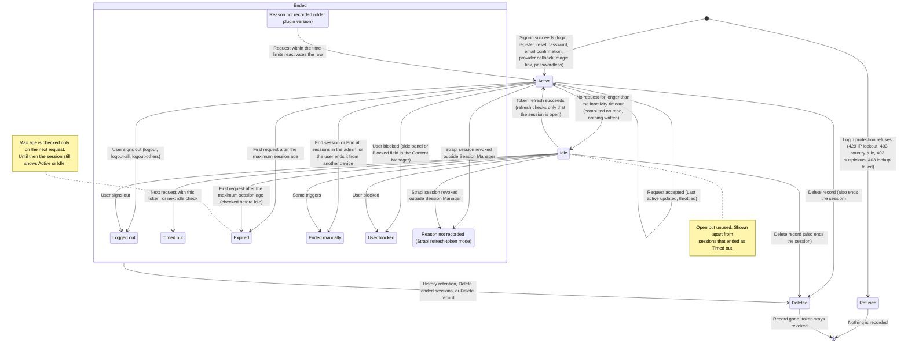
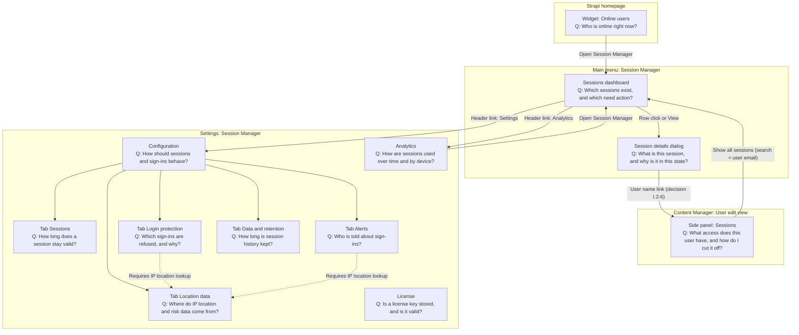

# Session Manager UI: information architecture (final)

Date: 2026-11-06. Companion to `docs/plans/2026-11-06-ui-redesign-design.md` (the "spec"). Evidence: `docs/audits/2026-11-06-ui-acceptance-review.md` (the "review") and the frozen-source facts brief.

Scope: Users & Permissions **end-user** sessions only. Strapi admin sessions are out of scope. Routes, request/response contracts, permissions and server code stay unchanged. Every change below is one of:

- **[label]**: copy or presentation only;
- **[client]**: client-side logic on data the screen already loads;
- **[query]**: a client-side URL query parameter on an existing admin page (no new route, no API change).

Decisions that need sign-off are collected in section I.2.

---

## 0. In one minute

- Session Manager records every sign-in of an end user (Users & Permissions) as a **session** and lets admins see, end and analyse them. Strapi admin accounts are never listed.
- A session is in one of three states: **Active** (open, recently used), **Idle** (open, unused longer than the inactivity timeout) or **Ended**. An ended session always carries an **end reason**: logged out, timed out, expired, ended manually, user blocked, or reason not recorded.
- Three verbs, three meanings: **End** a session (it stops working, the record stays), **Delete** a record (history is removed; an open session also ends), **Block** a user (no sign-in, all open sessions end).
- **Online** describes users, never sessions: a user is online when at least one of their sessions is Active. Every screen uses this one rule.
- **Sessions** (main menu) answers "which sessions exist and which need action?". The **detail dialog** answers "what is this one session and why is it in this state?".
- The **Sessions panel** on a user in the Content Manager answers "what access does this user have, and how do I cut it off?" (End all sessions, Block user). The **homepage widget** answers "who is online right now?".
- **Settings › Session Manager** has three links: **Configuration** (five tabs: Sessions, Login protection, Location data, Alerts, Data and retention), **Analytics** and **License**.
- Login protection acts on **new sign-ins only** and never records rejected attempts. Alerts and country rules need IP location lookup. The license key never gates features.

---

## A) Core concepts and glossary

Rule: one term per concept, one concept per term. The definition column is the exact text shown in the UI as helper text, a tooltip (Information icon next to the label) or the dashboard legend. German uses the formal *Sie*.

### A.1 Retired words

| Retired (en) | Use instead | Why |
|---|---|---|
| "Online" for sessions | "Active" (sessions); "Online" for users only | "Online now" counted sessions in Analytics and users in the widget |
| "Terminate", "Terminated" | "End", "Ended" + end reason | One verb for changing a session's state |
| "Remove session details" | "Delete record" | "Remove" and "delete" named the same hard delete |
| "Clean", "Clean now" | "Idle check" (the job that ends idle sessions) or "Delete ended sessions" (the hard delete) | "Clean" covered two unrelated operations |
| "Logout" as the end-time noun | "Ended at" | `logoutTime` is the end time for every reason |
| "Blocked" / "revoked" for tokens | "Revoked" | "Block" is reserved for user accounts |
| "Block suspicious sessions" | "Reject suspicious sign-ins" | The code refuses logins, not sessions |
| "Blocked countries" / "Blocklist" | "Reject listed countries" | "Block" is reserved for user accounts |
| "User will be blocked after {count} attempts" | "Temporary IP lockout" wording (A.6) | The code locks out an IP for 15 min, not the account |
| "Activation" (license page) | "License" | It shows status only; nothing is activated |
| "Offline" | "Not online" (users) | The widget's "Offline" counted never-signed-in users |

| Retired (de) | Use instead | Why |
|---|---|---|
| "Inaktiv" for any session state | "Im Leerlauf" (open, unused) or "Beendet" | "Inaktiv" meant idle, ended, license-inactive and the timeout |
| "Session" in running text | "Sitzung" | Product name "Session Manager" stays |
| "blockieren" | "sperren" (user accounts only); "ablehnen" (sign-ins) | Three mechanisms shared one word |
| "gesperrt" for tokens or countries | "widerrufen" (tokens); "abgelehnt" (countries) | — |
| "Abmeldung" as the end-time noun | "Beendet am" | — |
| "STRIKT / LOCKER", "ACTIVE", ALL-CAPS values | sentence case (H.3) | — |
| Mixed *Du* / *Sie* | *Sie* everywhere | Review I18N-6, UX-07 |

### A.2 People and sessions

| Concept (code) | en | de | UI definition (en) | UI definition (de) |
|---|---|---|---|---|
| End user (U&P user) | User | Benutzer | A person who signs in to your app through Users & Permissions. Strapi admin accounts are not managed here. | Eine Person, die sich über Users & Permissions an Ihrer App anmeldet. Strapi-Admin-Konten werden hier nicht verwaltet. |
| Session (row in `magic_sessions`, or a synthesised native-only row) | Session | Sitzung | One sign-in of a user on one device, from sign-in until it ends. | Eine Anmeldung eines Benutzers auf einem Gerät, von der Anmeldung bis zu ihrem Ende. |
| Session record | Session record | Sitzungsdatensatz | The stored details of a session: times, device, IP address and location. | Die gespeicherten Angaben zu einer Sitzung: Zeiten, Gerät, IP-Adresse und Standort. |
| Native-only row (`id` starts with `native_`) | Strapi session | Strapi-Sitzung | Created by Strapi's own session store. No device or location details were recorded. | Vom Sitzungsspeicher von Strapi angelegt. Gerät und Standort wurden nicht erfasst. |

### A.3 States

| Concept (code) | en | de | UI definition (en) | UI definition (de) |
|---|---|---|---|---|
| Open (`isActive === true`) | Open | Offen | A session that has not ended. It is either active or idle. | Eine Sitzung, die nicht beendet ist. Sie ist entweder aktiv oder im Leerlauf. |
| Active (`isActive && isTrulyActive`) | Active | Aktiv | Open and used within the inactivity timeout. | Offen und innerhalb des Inaktivitäts-Timeouts genutzt. |
| Idle (`isActive && !isTrulyActive`) | Idle | Im Leerlauf | Open, but not used for longer than the inactivity timeout. It ends on its next request or at the next idle check. A token refresh makes it active again. | Offen, aber länger als das Inaktivitäts-Timeout nicht genutzt. Sie endet bei der nächsten Anfrage oder der nächsten Leerlaufprüfung. Eine Token-Erneuerung macht sie wieder aktiv. |
| Ended (`isActive === false`) | Ended | Beendet | The session can no longer be used. The user has to sign in again on this device. | Die Sitzung kann nicht mehr verwendet werden. Der Benutzer muss sich auf diesem Gerät erneut anmelden. |

### A.4 End reasons

| Concept (code) | en | de | UI definition (en) | UI definition (de) |
|---|---|---|---|---|
| `terminationReason` | End reason | Grund für das Ende | Why the session ended. | Warum die Sitzung beendet wurde. |
| `logout` | Logged out | Abgemeldet | The user signed out. | Der Benutzer hat sich abgemeldet. |
| `idle` | Timed out | Zeitüberschreitung | Not used for longer than the inactivity timeout. | Länger als das Inaktivitäts-Timeout nicht genutzt. |
| `expired` | Expired | Abgelaufen | Reached the maximum session age. | Das maximale Sitzungsalter wurde erreicht. |
| `manual` | Ended manually | Manuell beendet | Ended from the Strapi admin, or by the user from another of their devices. | In der Strapi-Administration oder vom Benutzer auf einem anderen seiner Geräte beendet. |
| `blocked` | User blocked | Benutzer gesperrt | Ended because the user account was blocked. | Beendet, weil das Benutzerkonto gesperrt wurde. |
| no reason (with or without `logoutTime`) | Reason not recorded | Grund nicht erfasst | No end reason was stored, for example because the session ended in Strapi's own session store or was recorded by an older plugin version. | Es wurde kein Grund gespeichert, zum Beispiel weil die Sitzung im Sitzungsspeicher von Strapi endete oder von einer älteren Plugin-Version erfasst wurde. |

### A.5 Times and timing

| Concept (code) | en | de | UI definition (en) | UI definition (de) |
|---|---|---|---|---|
| `loginTime` | Signed in | Angemeldet am | When the session started. | Zeitpunkt, zu dem die Sitzung begann. |
| `lastActive` | Last active | Zuletzt aktiv | Time of the last request with this session. It is updated with a short delay to save database writes. | Zeitpunkt der letzten Anfrage mit dieser Sitzung. Er wird mit kurzer Verzögerung aktualisiert, um Schreibzugriffe zu sparen. |
| `logoutTime` | Ended at | Beendet am | When the session ended, whatever the reason. | Zeitpunkt, zu dem die Sitzung endete, unabhängig vom Grund. |
| `inactivityTimeout` | Inactivity timeout | Inaktivitäts-Timeout | How long a session may stay unused before it becomes idle and then ends. | Wie lange eine Sitzung ungenutzt bleiben darf, bevor sie in den Leerlauf geht und dann endet. |
| `maxSessionAgeDays` | Maximum session age | Maximales Sitzungsalter | How long a session may last from sign-in, regardless of activity. Applied on its next request. | Wie lange eine Sitzung ab der Anmeldung bestehen darf, unabhängig von der Aktivität. Wird bei der nächsten Anfrage angewendet. |
| Idle cleanup job | Idle check | Leerlaufprüfung | A scheduled job that ends idle sessions as "Timed out". It deletes nothing. | Ein geplanter Vorgang, der Sitzungen im Leerlauf mit „Zeitüberschreitung“ beendet. Er löscht nichts. |
| `retentionDays` | History retention | Aufbewahrung des Verlaufs | How long records of ended sessions are kept before they are deleted automatically. | Wie lange Datensätze beendeter Sitzungen aufbewahrt werden, bevor sie automatisch gelöscht werden. |

### A.6 Actions, users and protection

| Concept (code) | en | de | UI definition (en) | UI definition (de) |
|---|---|---|---|---|
| Online (user with ≥ 1 Active session) | Online / Not online | Online / Nicht online | The user has at least one active session. | Der Benutzer hat mindestens eine aktive Sitzung. |
| `POST /sessions/:id/terminate` | End session | Sitzung beenden | Signs the user out on this device. The record stays in the history. This cannot be undone. | Meldet den Benutzer auf diesem Gerät ab. Der Datensatz bleibt im Verlauf. Dies kann nicht rückgängig gemacht werden. |
| `POST /user/:id/terminate-all` | End all sessions | Alle Sitzungen beenden | Signs the user out on every device. The user can sign in again unless the account is blocked. | Meldet den Benutzer auf allen Geräten ab. Er kann sich erneut anmelden, sofern das Konto nicht gesperrt ist. |
| `DELETE /sessions/:id` | Delete record | Datensatz löschen | Permanently removes the session from history, statistics and exports. If the session is still open, it also ends. | Entfernt die Sitzung dauerhaft aus Verlauf, Statistik und Exporten. Ist die Sitzung noch offen, wird sie zusätzlich beendet. |
| `POST /sessions/clean-inactive` | Delete ended sessions | Beendete Sitzungen löschen | Permanently removes the records of all ended sessions of all users. Open sessions, including idle ones, are not affected. | Entfernt dauerhaft die Datensätze aller beendeten Sitzungen aller Benutzer. Offene Sitzungen, auch solche im Leerlauf, sind nicht betroffen. |
| `revoked-token` | Revoked | Widerrufen | After a record is deleted, its token stays on a revocation list and cannot be used again. | Nach dem Löschen eines Datensatzes bleibt sein Token auf einer Widerrufsliste und kann nicht erneut verwendet werden. |
| U&P `blocked` | Block user / Unblock user; Blocked | Benutzer sperren / Sperre aufheben; Gesperrt | A blocked user cannot sign in, and all open sessions end. Unblocking allows sign-in again but does not restore ended sessions. | Ein gesperrter Benutzer kann sich nicht anmelden, und alle offenen Sitzungen enden. Das Aufheben der Sperre erlaubt wieder die Anmeldung, stellt beendete Sitzungen aber nicht wieder her. |
| `strictSessionEnforcement` | Token check: Strict / Relaxed | Token-Prüfung: Streng / Tolerant | Decides what happens to a token that has no session record, and to requests where the check itself fails. Ended, expired and revoked sessions and blocked users are rejected in both modes. | Legt fest, was mit einem Token ohne Sitzungsdatensatz geschieht und mit Anfragen, bei denen die Prüfung selbst fehlschlägt. Beendete, abgelaufene und widerrufene Sitzungen sowie gesperrte Benutzer werden in beiden Modi abgelehnt. |
| `sessionCreationGraceMs` | Grace period after sign-in | Karenzzeit nach der Anmeldung | A short window after sign-in in which a token is accepted while its session record is still being created. | Kurzes Zeitfenster nach der Anmeldung, in dem ein Token akzeptiert wird, während sein Sitzungsdatensatz noch angelegt wird. |
| `maxFailedLogins` | Temporary IP lockout | Vorübergehende IP-Sperre | After too many failed sign-ins from one IP address within 15 minutes, that address is refused for 15 minutes. User accounts are not blocked. | Nach zu vielen fehlgeschlagenen Anmeldungen von einer IP-Adresse innerhalb von 15 Minuten wird diese Adresse 15 Minuten lang abgewiesen. Benutzerkonten werden nicht gesperrt. |
| `trustedProxies` | Trust proxy headers | Proxy-Headern vertrauen | Reads the client IP address from proxy headers. Turn this on only behind a proxy you control. | Liest die Client-IP-Adresse aus Proxy-Headern. Aktivieren Sie dies nur hinter einem Proxy, den Sie selbst betreiben. |
| `enableGeolocation` | IP location lookup | IP-Standortabfrage | Determines country and city for an IP address at sign-in. Required by country rules, suspicious-sign-in checks and alerts. | Ermittelt bei der Anmeldung Land und Stadt einer IP-Adresse. Erforderlich für Länderregeln, Prüfungen auf verdächtige Anmeldungen und Benachrichtigungen. |
| `securityScore` | Security score | Sicherheitswert | 0–100 rating of the sign-in IP address. Higher is safer. The local database always gives 100, and a failed lookup gives 50. | Bewertung der Anmelde-IP-Adresse von 0 bis 100. Höher ist sicherer. Die lokale Datenbank liefert immer 100, eine fehlgeschlagene Abfrage 50. |
| Suspicious sign-in | Suspicious sign-in | Verdächtige Anmeldung | A sign-in from a VPN, proxy or known threat address, or with a low security score when scoring is on. | Eine Anmeldung über VPN, Proxy oder eine bekannte Bedrohungsadresse oder, bei aktivierter Bewertung, mit niedrigem Sicherheitswert. |
| `enableGeofencing` + lists | Country rules | Länderregeln | Allow or reject new sign-ins by the country of the IP address. | Neue Anmeldungen anhand des Landes der IP-Adresse zulassen oder ablehnen. |
| `allowedCountries` / `blockedCountries` | Allow only listed countries / Reject listed countries | Nur aufgeführte Länder zulassen / Aufgeführte Länder ablehnen | — | — |
| Email alerts | Security emails to users | Sicherheits-E-Mails an Benutzer | Emails sent to the end user's own address about their sign-ins, not to administrators. | E-Mails an die eigene Adresse des Endbenutzers zu seinen Anmeldungen, nicht an Administratoren. |
| Webhooks | Team notifications | Team-Benachrichtigungen | Messages to your Discord or Slack channel for every sign-in. | Nachrichten an Ihren Discord- oder Slack-Kanal bei jeder Anmeldung. |
| License | License | Lizenz | Optional license key for this installation. All features work without a key. | Optionaler Lizenzschlüssel für diese Installation. Alle Funktionen sind auch ohne Schlüssel verfügbar. |

---

## B) Session lifecycle state model

### B.1 Derivation (replaces `admin/src/utils/sessionStatus.mjs`) [client]

```
isActive && isTrulyActive   → state 'active'
isActive && !isTrulyActive  → state 'idle'
!isActive                   → state 'ended', reason = terminationReason ?? 'unrecorded'
```

`terminationReason` already reaches the admin (`sessionStatus.mjs:12-14` reads it; `enhance-session.js` strips only token fields). A legacy row with no reason but a `logoutTime` is **no longer** guessed as "Logged out"; it shows "Reason not recorded" (decision I.2-1).

### B.2 State diagram

Two runtime modes produce rows without a reason, and they behave differently, so they are drawn as two nodes that share one display label.



### B.3 How each state is shown (one mapping for every screen)

Badge = state. Reason = a text line under the badge. Colour never carries meaning on its own. Danger colour is reserved for destructive buttons and the "user is blocked" alert, because an ended session is not an error. Triage by reason uses the reason filter (D1), not colour.

| UI state | Badge (DS `Badge`) | Badge label en / de | Second line (table, card) | Helper text (tooltip on badge; state sentence in the dialog) |
|---|---|---|---|---|
| Active | success | Active / Aktiv | "Last active {relative}" in neutral text | en "Open and used within the inactivity timeout." · de „Offen und innerhalb des Inaktivitäts-Timeouts genutzt.“ |
| Idle | warning | Idle / Im Leerlauf | "Not used for {minutesSinceActive} min" in neutral text | en "Still open. It ends on its next request or at the next idle check. A token refresh makes it active again." · de „Noch offen. Sie endet bei der nächsten Anfrage oder der nächsten Leerlaufprüfung. Eine Token-Erneuerung macht sie wieder aktiv.“ |
| Ended · Logged out | neutral | Ended / Beendet | "Logged out · {Ended at}" | A.4 `logout` |
| Ended · Timed out | neutral | Ended / Beendet | "Timed out · {Ended at}" | A.4 `idle` |
| Ended · Expired | neutral | Ended / Beendet | "Expired · {Ended at}" | A.4 `expired` |
| Ended · Ended manually | neutral | Ended / Beendet | "Ended manually · {Ended at}" | A.4 `manual` |
| Ended · User blocked | neutral | Ended / Beendet | "User blocked · {Ended at}" | A.4 `blocked` |
| Ended · Reason not recorded | neutral | Ended / Beendet | "Reason not recorded · {Ended at or —}" | A.4 no reason. Native-reconciled rows have no `logoutTime`, so "Ended at" shows "—". |

Additional display rules:

- Only `minutesSinceActive` and timestamps from the row are used in helper text. Numbers that need settings (timeout minutes, max age) are not shown on the dashboard, because it does not load settings (decision I.2-5).
- "Last active …" is never green, on any surface (fixes review F3).
- Native-only rows keep their state badge and get a second neutral `Badge` "Strapi session" / "Strapi-Sitzung" with the A.2 helper. Device, IP and location show "—" ("Not recorded").
- A session past the maximum age but not yet hit by a request keeps its Active/Idle badge. The dialog adds the sentence "Sessions older than the maximum session age end on their next request." without a number.

---

## C) Navigation map

Entry points stay as they are: one main-menu page, settings links under "Session Manager", one homepage widget, one Content Manager side panel. Only labels change, and two cross-links use a URL query on existing pages [query].



| Entry | Label en / de | Single question |
|---|---|---|
| Main menu page | Session Manager (page title "Sessions" / „Sitzungen“) | Which sessions exist, and which need action? |
| Dialog | Session details / Sitzungsdetails | What is this session, and why is it in this state? |
| Settings link 1 (was "General") | Configuration / Konfiguration | How should sessions and sign-ins behave? |
| Settings link 2 | Analytics / Auswertung | How are sessions used over time and by device? |
| Settings link 3 (was "Activation") | License / Lizenz | Is a license key stored, and is it valid? |
| Homepage widget | Online users / Online-Benutzer | Who is online right now? |
| Content Manager panel | Sessions / Sitzungen | What access does this user have, and how do I cut it off? |

Navigation rules:

- Settings tabs are deep-linkable with `?tab=sessions|login-protection|location-data|alerts|data-retention` [query], so "Requires IP location lookup" links land on the right tab.
- Dashboard filters, search, page and page size live in the URL (`useQueryParams`), so "Show all sessions" from the panel is a plain link with `?search=<email>`.

---

## D) Per screen

Shared anatomy (spec "PageShell"): `Page.Main` → `Layouts.Header` (title, subtitle, primary action right) → `Layouts.Content` with no extra padding (fixes DASH-03, SET-10, F14). White `SectionCard`s with an h2; h3 inside cards only. DS breakpoints only: small 520, medium 768, large 1080.

### D1. Sessions dashboard (main menu)

- **Purpose:** monitor sessions and act on individual ones.
- **Primary question:** "Which sessions exist, and which need my action?"

**Desktop (≥ 1080), top to bottom:**

1. **Header.** Title "Sessions" / „Sitzungen“. Subtitle "Sign-ins of your app's users (Users & Permissions). Strapi administrators are not listed." / „Anmeldungen der Benutzer Ihrer App (Users & Permissions). Strapi-Administratoren werden nicht angezeigt.“ Primary action **Export** (`SimpleMenu`: "Export {count} sessions as CSV", "… as JSON"); disabled with a tooltip "No sessions match the current filter." when the filtered list is empty. Secondary text links (tertiary buttons): "Analytics", "Settings".
2. **Truncation alert** [client], only when `meta.truncated` is true (the API already sends it; no admin UI reads it today). Neutral `Alert`: "Only the latest 1,000 sessions are loaded. Counts, filters and exports cover these sessions only." / „Es werden nur die neuesten 1.000 Sitzungen geladen. Zahlen, Filter und Exporte beziehen sich nur auf diese Sitzungen.“
3. **"How sessions work" disclosure** (collapsed by default; open state remembered per viewer in `localStorage`, wrapped in try/catch). Contains the three-row legend: badge + label + A.3 definition for Active, Idle, Ended, and one line: "Ended sessions stay in the history until they are deleted."
4. **StatGrid, 4 equal cards**, each a button that sets the status filter [client]:
   - **Active** sessions; secondary line "{n} users online" (distinct users with an Active session; one user can have several sessions).
   - **Idle** sessions (open only).
   - **Ended** sessions; secondary line "{a} logged out · {b} timed out · {c} other reasons".
   - **All** sessions.
5. **Action bar.** Left: `SearchInput`, placeholder "Search user, email, IP or device" (short enough not to truncate at 1024; DASH-11). Right: **Status** `SingleSelect` (All sessions · Open · Active · Idle · Ended); when "Ended" is selected a second `SingleSelect` **End reason** appears (All reasons · Logged out · Timed out · Expired · Ended manually · User blocked · Reason not recorded) [client]; then a Refresh `IconButton` [client]. Below the bar, `pi` neutral600: "Last updated {relative}" (the list also refreshes every 10 minutes while the dialog is closed).
6. **Caption** (polite live region): "{from}–{to} of {total} sessions".
7. **Table** (DS `Table`, no fixed min-width):

   | Column | Content |
   |---|---|
   | Status | Badge + second line (B.3) |
   | User | Username; email below (ellipsis with title) |
   | Device | Device-type icon + "{browser} · {os}"; "Unknown device" when not parsed; "—" for native-only rows |
   | IP address | Monospace |
   | Signed in | Absolute date and time |
   | Last active | Relative; absolute in tooltip |
   | Actions | `IconButton` **View details** · `IconButton` **End session** (disabled on ended rows, tooltip "This session has already ended") · `IconButton` **More actions** → "Delete record". Every label includes the username: "End session of {user}". |

   Clicking a row opens the dialog; rows are not separate tab stops (DASH-01, DUX-08).
8. **Footer:** "Entries per page" (10/25/50/100, default 25) left, `Pagination` right.

- **Primary:** state, user, last active, End session.
- **Secondary:** device, IP address, signed-in time, filters, export.
- **Behind the dialog:** end time and reason text, location, security score, raw user agent, record ID, user ID.

**Below large (768–1079):** IP address and Signed in columns are hidden (still in the dialog). Stat cards 2 × 2.

**Below medium (< 768):** the table becomes a card list. Card order: badge + second line; user (name, email); device · IP; row of equal-width buttons "Details", "End session" (open rows only), "More" (Delete record). Search goes full width; Status, End reason and Refresh wrap to the next row. Export stays in the header as a menu button. Below small (520): stat cards 1 column; the disclosure stays above the stats.

### D2. Session details (dialog)

- **Purpose:** the complete record of one session.
- **Primary question:** "What is this session, and why is it in this state?"

**Desktop, top to bottom (two-column `PropertyList` inside sections; one column below small):**

1. **Header:** device icon (decorative), "Session details", state badge.
2. **State sentence** (always visible, plain language):
   - Active: "Active. Last request {relative}."
   - Idle: warning `Alert`: "Not used for {minutesSinceActive} min. It ends on its next request or at the next idle check."
   - Ended: "Ended {Ended at} · {reason}." plus the reason definition from A.4.
   - Open rows also show: "Sessions older than the maximum session age end on their next request."
3. **User:** username, email. Username is a link "Open user" to the Content Manager edit view only if the row carries the user's `documentId` (decision I.2-6).
4. **Session:** Signed in, Last active, Ended at (ended only), End reason (ended only).
5. **Device:** device type, browser, operating system, IP address.
6. **Location and security:**
   - Country (with flag as decorative), city, time zone.
   - Security score "{score}/100" with the fixed note: "Higher is safer. Below 70 can trigger a suspicious-sign-in email and below 50 a rejection, if those settings are on. Local database results are always 100." The client-side "below 50 = High, else Low" mapping is removed [client].
   - Risk level only when a live lookup returns `riskLevel`, translated (H.12).
   - VPN / Proxy: separate keys; "Yes" / "No" from a live lookup; "Not stored for past sign-ins" when the location came from the stored record. No "[WARNING]" prefix.
   - When no location is stored: a secondary button **Look up location** with the hint "Sends the IP address to the configured lookup service, which can be ipapi.co." [client; decision I.2-7]. When lookup is off on the server, the response placeholder is shown as "IP location lookup is off."
7. **Technical details** (`Accordion`, collapsed): record ID with copy button, raw user agent, the Strapi-session note for native-only rows.
8. **Footer:** "Close" (tertiary) left; **End session** (danger-light, opens the confirmation) right, open rows only. Ended rows show the text "This session has already ended." instead. Delete record is not offered here, so the dialog has at most one destructive action.

**Mobile (< 520):** full-height dialog, one column, sections in the same order, footer buttons full width with End session first, technical section collapsed.

### D3. Content Manager side panel "Sessions" (User edit view only)

- **Purpose:** session access of one user.
- **Primary question:** "What access does this user have, and how do I cut it off?"

**Layout, top to bottom:**

1. **Summary:** user badge "Online" (success) if any open session is Active, else "Not online" (neutral); then "{n} open sessions" with hint "Active or idle"; then "Last active {relative}", the latest `lastActive` over all rows the panel already receives [client], or "No sessions recorded" when none.
2. **Blocked alert** (danger), when blocked: "This account is blocked. The user cannot sign in." / „Dieses Konto ist gesperrt. Der Benutzer kann sich nicht anmelden.“ After Block/Unblock the form's `blocked` field is synced via `useForm` (spec); if the form context is missing: warning alert "Reload this page before saving, or the Blocked field will be overwritten."
3. **Actions** (full width, equal height, each its own spinner; fixes UX-13):
   - **End all sessions** (danger-light), disabled when n = 0 with the hint "No open sessions".
   - **Block user** (danger-light) or **Unblock user** (secondary).
   - Hint under the buttons: "End all sessions lets the user sign in again. Block user also prevents new sign-ins."
4. **Open sessions:** up to 5 compact cards sorted by last active: state badge (Active/Idle), translated device type with matching icon (UX-03), "{browser} · {os}", IP address, "Last active {relative}" in neutral text. Then "+{n} more".
5. **Link:** "Show all sessions" → dashboard with `?search=<email>`.

- **Primary:** online badge, open-session count, both actions.
- **Secondary:** session cards.
- **Not here:** ended sessions (they are in the dashboard).

**Unsaved user:** only "Save this user before you can manage sessions." / „Speichern Sie diesen Benutzer, bevor Sie Sitzungen verwalten können.“

**Mobile:** the panel is one column already; buttons full width; touch targets ≥ 32 px.

### D4. Homepage widget "Online users"

- **Purpose:** a glance at presence.
- **Primary question:** "Who is online right now?"

**Layout:** 2 × 2 grid of equal tiles, then a link "Open Session Manager".

| Tile | Value | Secondary line |
|---|---|---|
| Online users | Distinct users with an Active session [client] | "of {total} registered users" (from `/users/stats`) |
| Active sessions | `isActive && isTrulyActive` | — |
| Idle sessions | `isActive && !isTrulyActive` | — |
| Blocked users | `/users/stats` blocked count | — |

- "Online" uses the same rule as the dashboard and panel (the configured inactivity timeout via `isTrulyActive`, which the widget's existing `GET /sessions` already returns) instead of hard-coded 15/30 min. The duplicate "Last 15 min", "Last 30 min" and the misleading "Offline" tiles are removed (decision I.2-2).
- Data and polling stay as they are (`GET /sessions` + `GET /users/stats`, every 30 s).
- **Mobile:** 2 columns from 520 up, 1 column below; no overflow at 320 (fixes F10).

### D5. Settings › Configuration

- **Purpose:** all session and sign-in rules for the instance.
- **Primary question:** "How should sessions and sign-ins behave?" Each tab answers one question (F).

**Layout:**

1. **Header:** title "Session Manager configuration", subtitle "Applies to all end-user sessions of this Strapi instance." Primary **Save** (disabled when nothing changed, loading while saving), secondary **Discard changes** (disabled when nothing changed). `Blocker` before leaving with unsaved changes.
2. **Tabs:** Sessions · Login protection · Location data · Alerts · Data and retention.
3. Each tab: one intro sentence, then `SectionCard`s in the order of F. Inside a card: intro sentence, fields in a 6/6 grid, then a collapsed "Advanced" accordion where F marks fields as advanced.
4. Dependent fields stay visible but disabled with "Requires {setting}" and a link to the owning tab, so admins can see what exists.
5. **Footer note:** "Saved in the database. Other server processes apply changes within 30 seconds." (Replaces "Changes take effect immediately".)

- **Primary:** everyday fields. **Secondary:** advanced accordions. **Hidden:** rate-limit keys (F, "Not shown").

**Mobile:** tabs scroll horizontally inside the tab list (never the page); fields 1 column below medium; Save stays in the header; danger card button wraps under its text below small.

### D6. Settings › Analytics

- **Purpose:** usage patterns from the loaded sessions.
- **Primary question:** "How are sessions used over time and by device?"

**Desktop, top to bottom:**

1. **Header:** "Analytics", subtitle "Based on the latest {n} loaded sessions." Secondary: Refresh (keeps the page mounted). Truncation alert as on D1 when it applies. Tertiary link "Open Session Manager".
2. **StatGrid, 4 KPIs:** All sessions · Active sessions (renamed from "Online now"; it counts sessions) · Sign-ins in the last 24 hours · Sign-ins in the last 7 days (both rolling windows).
3. **Two equal-height cards:** Devices and Browsers; value label outside the bar fill (F4); translated bucket labels (UX-09). Footnote: "Detected from the browser's user agent." Sessions without a user agent (for example Strapi sessions) appear as "Unknown" (decision I.2-3).
4. **Full-width card "Average session length".** Description: "From sign-in to the end of the session, or to its last activity while it is still open. Sessions that timed out include the unused time before they were closed." (Matches `logoutTime ‖ lastActive ‖ now`.)

**Mobile:** KPIs 2 columns, 1 below small; cards stacked.

### D7. Settings › License

- **Purpose:** license status, read-only.
- **Primary question:** "Is a license key stored, and is it valid?"

**Layout:**

1. **Header:** "License"; secondary actions "Check again" (keeps the page mounted, F8) and "Download as text" (only with a key; admin-locale dates, F18).
2. **Status card** with exactly one state and the fixed sentence "All features are available with or without a key.":
   - "No license key stored."
   - "License valid until {date}." / "License expired on {date}."
   - "The license status could not be checked."
3. **Details** (`PropertyList`, only with a key): holder, email, expires, device name, IP address, last check, device limit, "License server reachable: Yes/No". No "Active/Inactive" or "Online/Offline" wording.
4. **Key:** masked field with Reveal and Copy.

There is no create or activate UI, because no UI calls those routes.

**Mobile:** one column; header actions wrap under the title.

---

## E) Action logic

Rules for every action:

- Destructive confirmations use Strapi `ConfirmDialog`, never `window.confirm`.
- Title = question with the glossary verb; body = who and what is affected, what happens now, and whether it can be undone; confirm button repeats the verb; cancel is always "Cancel" / „Abbrechen“.
- Focus returns to the trigger, or to the next row (else the table caption) when the row is gone.
- Feedback uses `useNotification`. Lists refresh in place without unmounting (DUX-02, DASH-17).

### E.1 Session and user actions

| Action | Where | Effect (code) | Scope | Reversible | Confirmation en (title / body / button) | Confirmation de | Feedback |
|---|---|---|---|---|---|---|---|
| End session | Dashboard row (table and card); dialog footer | In refresh-token mode the Strapi session is revoked first. Row gets reason `manual` and an end time. The user's next request gets 401 with reason `manual`; refresh fails. Record kept. | One session | No; the user must sign in again | "End this session?" / "{user} will be signed out on {device}. Their other sessions stay open. The record stays in the history. This cannot be undone." / **End session** | „Diese Sitzung beenden?“ / „{user} wird auf {device} abgemeldet. Andere Sitzungen bleiben bestehen. Der Datensatz bleibt im Verlauf. Dies kann nicht rückgängig gemacht werden.“ / **Sitzung beenden** | Success: "Session ended." / „Sitzung beendet.“ Row shows Ended · Ended manually. 404: "This session no longer exists. The list was refreshed." Other: "The session could not be ended. Please try again." / „Die Sitzung konnte nicht beendet werden. Bitte versuchen Sie es erneut.“ |
| End all sessions | Side panel | All open rows of the user get reason `manual`; in refresh-token mode all Strapi sessions are revoked. | One user, all devices | No | "End all sessions of {user}?" / "{count} open sessions end on all devices. {user} can sign in again unless you also block the account." / **End all sessions** | „Alle Sitzungen von {user} beenden?“ / „{count} offene Sitzungen werden auf allen Geräten beendet. {user} kann sich erneut anmelden, sofern Sie das Konto nicht zusätzlich sperren.“ / **Alle Sitzungen beenden** | Success: "All sessions of {user} ended." / „Alle Sitzungen von {user} wurden beendet.“ 404: "User not found." / „Benutzer nicht gefunden.“ Other: "The sessions could not be ended. Please try again." |
| Delete record (ended row) | Dashboard "More actions" (table and card) | Revocation entry written, row hard-deleted. Gone from lists, analytics and exports. | One record | No (data loss) | "Delete this session record?" / "The record is removed permanently from history, statistics and exports. This cannot be undone." / **Delete record** | „Diesen Sitzungsdatensatz löschen?“ / „Der Datensatz wird dauerhaft aus Verlauf, Statistik und Exporten entfernt. Dies kann nicht rückgängig gemacht werden.“ / **Datensatz löschen** | Success: "Session record deleted. Its token stays revoked." / „Sitzungsdatensatz gelöscht. Sein Token bleibt widerrufen.“ Error: "The record could not be deleted. Please try again." / „Der Datensatz konnte nicht gelöscht werden. Bitte versuchen Sie es erneut.“ |
| Delete record (open row) | Same | As above; the open session also ends (refresh-token mode: Strapi session revoked). | One session and its record | No | "Delete record and end session?" / "This session is still open. {user} will be signed out on {device}, and the record is removed from history, statistics and exports. This cannot be undone." / **Delete and end** | „Datensatz löschen und Sitzung beenden?“ / „Diese Sitzung ist noch offen. {user} wird auf {device} abgemeldet, und der Datensatz wird aus Verlauf, Statistik und Exporten entfernt. Dies kann nicht rückgängig gemacht werden.“ / **Löschen und beenden** | As above |
| Delete ended sessions | Configuration › Data and retention, danger card | Hard-deletes every `isActive:false` row of all users; revocations kept. Open and idle sessions untouched; the idle check does not run. | All users' history | No | "Delete all ended sessions?" / "The records of every ended session of every user are removed permanently from history, statistics and exports. Open sessions, including idle ones, are not affected. This cannot be undone." / **Delete ended sessions** | „Alle beendeten Sitzungen löschen?“ / „Die Datensätze aller beendeten Sitzungen aller Benutzer werden dauerhaft aus Verlauf, Statistik und Exporten entfernt. Offene Sitzungen, auch solche im Leerlauf, sind nicht betroffen. Dies kann nicht rückgängig gemacht werden.“ / **Beendete Sitzungen löschen** | Success: "{count} ended sessions deleted." / „{count} beendete Sitzungen gelöscht.“ For 0: "There were no ended sessions to delete." Error: "Ended sessions could not be deleted. Some may already be gone; reload to see the current state." (the server can stop part-way, API-9) |
| Block user | Side panel (the native Blocked field in the Content Manager form has the same effect through a lifecycle hook, without this dialog) | `blocked = true`; all open sessions end with reason `blocked`; sign-in refused even without a session. | One user | Partly: Unblock allows sign-in again; ended sessions stay ended | "Block {user}?" / "{user} can no longer sign in, and {count} open sessions end now. You can unblock the account later; ended sessions stay ended." / **Block user** | „{user} sperren?“ / „{user} kann sich nicht mehr anmelden, und {count} offene Sitzungen werden sofort beendet. Sie können die Sperre später aufheben; beendete Sitzungen bleiben beendet.“ / **Benutzer sperren** | Success: "{user} is blocked." / „{user} ist gesperrt.“ Form field synced. Error: "The user could not be blocked. Please try again." / „Der Benutzer konnte nicht gesperrt werden. Bitte versuchen Sie es erneut.“ |
| Unblock user | Side panel | `blocked = false` only. | One user | Yes | None (not destructive); button shows a loading state | — | Success: "{user} can sign in again." / „{user} kann sich wieder anmelden.“ Error: "The block could not be removed. Please try again." / „Die Sperre konnte nicht aufgehoben werden. Bitte versuchen Sie es erneut.“ |
| Export CSV / JSON | Dashboard header | Client-side; the filtered list across all pages, from the ≤ 1,000 loaded rows; no tokens. Columns unchanged unless decision I.2-4. | None | n/a | None | — | Browser download. When truncated, the menu items read "… (latest 1,000 sessions only)". Error: "The export could not be created." / „Der Export konnte nicht erstellt werden.“ |
| Refresh | Dashboard, Analytics | Re-runs the existing GET | None | n/a | None | — | "Last updated" changes; layout, focus and scroll stay. |
| Look up location | Dialog, only without stored location | `GET /geolocation/:ip` | None (may send the IP to ipapi.co) | n/a | None; the privacy hint sits next to the button | — | Result fills the section. Error: "The location could not be determined." / „Der Standort konnte nicht ermittelt werden.“ |

### E.2 Settings and license actions

| Action | Where | Effect (code) | Scope | Reversible | Confirmation en | Confirmation de | Feedback |
|---|---|---|---|---|---|---|---|
| Save settings | Configuration header | `PUT /settings` replaces the whole object. The server clamps values, turns missing booleans into false, empties non-Discord/Slack webhook URLs and sanitises email HTML. Other processes pick it up within 30 s. | Whole instance | Only by editing again | None. Inline validation (`Field.Error`) blocks Save while a field is invalid. | — | Success: "Settings saved." / „Einstellungen gespeichert.“ [client] The form re-reads `response.settings`; if anything differs from the draft: "Settings saved. Some values were adjusted to the allowed limits: {fields}." Error: "Settings could not be saved. Your changes are still in the form." / „Die Einstellungen konnten nicht gespeichert werden. Ihre Änderungen sind noch im Formular.“ |
| Discard changes (was "Reset") | Configuration header | Re-loads the stored settings into the form. It does **not** restore defaults. | Draft only | No | "Discard unsaved changes?" / "Your changes on all tabs are lost." / **Discard** | „Ungespeicherte Änderungen verwerfen?“ / „Ihre Änderungen auf allen Reitern gehen verloren.“ / **Verwerfen** | Form resets in place; the open tab and focus stay (SET-11). |
| Leave with unsaved changes | Any navigation away from Configuration | — | Draft | — | Strapi `Blocker` standard copy | Strapi standard | — |
| Switch country rule mode | Login protection | Clears the draft list of the other mode; applied on Save. | Draft | Until Save | "Switch to {mode}?" / "The current list of {count} countries is cleared when you save." / **Switch mode** | „Zu {mode} wechseln?“ / „Die aktuelle Liste mit {count} Ländern wird beim Speichern geleert.“ / **Modus wechseln** | Radio state updates; focus stays on the radio. |
| Save MaxMind credentials | Location data | `PUT /geoip/credentials`; stored in the plugin store; environment variables take precedence. | Instance | Yes | None | — | "Credentials saved." / „Zugangsdaten gespeichert.“ If the source is `env`: persistent hint "Environment variables are set and take precedence; stored values are ignored." |
| Remove MaxMind credentials | Location data | `PUT /geoip/credentials {clear:true}` | Instance | Yes | "Remove stored MaxMind credentials?" / "Updates of the GeoIP database stop working unless credentials are set as environment variables." / **Remove** | „Gespeicherte MaxMind-Zugangsdaten entfernen?“ / „Aktualisierungen der GeoIP-Datenbank funktionieren dann nur noch mit Zugangsdaten aus Umgebungsvariablen.“ / **Entfernen** | "Credentials removed." / „Zugangsdaten entfernt.“ |
| Update GeoIP database / Force download | Location data | `POST /geoip/update` (`force` for the second button); downloads GeoLite2 City, else Country. 400 without credentials. | Instance lookups | Re-download | None; disabled without credentials with the hint "Add MaxMind credentials first." | — | Loading state; success: "GeoIP database updated: {edition}, built {date}." Error: the server message. |
| Generate encryption key | Sessions › Advanced | Client-side only; nothing is saved. The key stays hidden until revealed. "Copy for .env" copies `SESSION_ENCRYPTION_KEY="…"` (quoted, SET-01). | None | n/a | None | — | "Copied. Add it to your server environment and restart Strapi." / „Kopiert. Fügen Sie ihn Ihrer Serverumgebung hinzu und starten Sie Strapi neu.“ |
| Check again / Copy / Download (license) | License | `GET /license/status`; copy and download are client-side | None | n/a | None | — | Status refreshes in place; "Copied." / „Kopiert.“ Errors appear as an alert in the status card. |

There is no webhook test and no license creation in the UI, and none is proposed.

---

## F) Settings grouping

General rules:

- Units are input suffixes (min, days, s, attempts). The grace period is stored in ms and shown in seconds; milliseconds are never shown.
- Selects show readable values ("5 s", "Forever"). If a stored value is not one of the options (for example set through config), it is shown as an extra option "{value} (custom)" instead of being replaced.
- Validation uses the server ranges inline with `Field.Error`; the UI never clamps silently.
- A disabled dependent field says why ("Requires IP location lookup") and links to the owning tab.
- "Adv." = inside the card's collapsed "Advanced" accordion.

### Tab 1 — Sessions: "How long does a session stay valid?"

Tab intro: "These rules decide when an end user's session ends. They are checked on every request the user makes." / „Diese Regeln legen fest, wann die Sitzung eines Endbenutzers endet. Sie werden bei jeder Anfrage des Benutzers geprüft.“

**Card 1.1 "Session lifetime".** Intro: "A session ends when it is unused for too long or reaches its maximum age."

| # | Field en / de | Key | Default | Unit / options (server range) | Depends on | Adv. | Helper (en) |
|---|---|---|---|---|---|---|---|
| 1 | Inactivity timeout / Inaktivitäts-Timeout | `inactivityTimeout` | 15 | min; 5/10/15/30/60/120 (1–1440) | — | | "A session unused for this long becomes idle and ends as 'Timed out' on its next request or at the next idle check. Also decides who counts as online." |
| 2 | Maximum session age / Maximales Sitzungsalter | `maxSessionAgeDays` | 30 | days; 1/7/14/30/60/90/180/365 (1–365) | — | | "Counted from sign-in, regardless of activity. Applied on the session's next request; until then the session can still show as active or idle." |
| 3 | Update "Last active" at most every / „Zuletzt aktiv“ höchstens aktualisieren alle | `lastSeenRateLimit` | 30 | s; 10/30/60/120/300 (5–300) | — | ✓ | "Lower values make 'Last active' and idle detection more precise but write to the database more often." Warning if it is not clearly shorter than the inactivity timeout. |
| 4 | Run idle check every / Leerlaufprüfung alle | `cleanupInterval` | 30 | min; 15/30/60/120 (5–1440; minimum 5) | — | ✓ | "The idle check ends idle sessions as 'Timed out'. It deletes nothing. It also runs once at server start." |
| 5 | Idle check method / Methode der Leerlaufprüfung | `cleanupUseDbDirect` | Document Service | Document Service / Direct SQL | — | ✓ | "Direct SQL is faster but skips lifecycle hooks. Ignored when Strapi's refresh-token mode is on." |

**Card 1.2 "Token check".** Intro: "Decides what happens to a token that Session Manager has no record for. Ended, expired and revoked sessions and blocked users are always rejected."

| # | Field en / de | Key | Default | Unit / options | Depends on | Adv. | Helper (en) |
|---|---|---|---|---|---|---|---|
| 1 | Token check / Token-Prüfung | `strictSessionEnforcement` | Relaxed | Switch with badge "Strict" / "Relaxed" (de „Streng“ / „Tolerant“) | — | | Strict: "Rejects tokens without a session record and requests where the check itself fails." Relaxed shows a warning `Alert`: "Tokens without a session record are accepted. If the check itself fails, up to 10 requests per minute are still allowed." |
| 2 | Grace period after sign-in / Karenzzeit nach der Anmeldung | `sessionCreationGraceMs` | 5 s | Off/2/5/10/30 s (0–30000 ms) | — | ✓ | "Accepts a new token for a few seconds while its session record is being created. Only for tokens without a session record. Not used when Strapi's refresh-token mode (jwtManagement: 'refresh') is on." (The admin cannot detect the mode, so the hint states it.) |
| 3 | Token encryption key / Token-Schlüssel (generator) | env `SESSION_ENCRYPTION_KEY` | — | client-side tool | — | ✓ | "Session Manager encrypts stored tokens with this environment variable. Not needed in Strapi's refresh-token mode. Nothing is saved here." |

**Card 1.3 "When a session is rejected"** (read-only). Intro: "What your app receives when a request uses an ended session." One sentence plus a list: "The response is 401 with the header X-Session-Terminated-Reason and the reason: logout, manual, idle, expired or blocked." This is kept apart from Tab 2, because it concerns existing sessions, not sign-ins.

### Tab 2 — Login protection: "Which sign-ins are refused, and why?"

Tab intro: "These rules check new sign-ins before they succeed. Existing sessions are not affected, and refused sign-ins are not recorded." / „Diese Regeln prüfen neue Anmeldungen, bevor sie erfolgreich sind. Bestehende Sitzungen sind nicht betroffen, und abgelehnte Anmeldungen werden nicht erfasst.“

**Card 2.1 "Failed sign-ins".** Intro: "Slows down password guessing from one IP address."

| # | Field en / de | Key | Default | Unit / range | Depends on | Adv. | Helper (en) |
|---|---|---|---|---|---|---|---|
| 1 | Temporary IP lockout after / Vorübergehende IP-Sperre nach | `maxFailedLogins` | 5 | failed sign-ins; 0–100, 0 = off | — | | "After {count} failed sign-ins from one IP address within 15 minutes, that address is refused for 15 minutes. User accounts are not blocked. Counted per server process." (Separate key from the description; fixes I18N-1 / SET-02.) |

**Card 2.2 "Client IP address".** Intro: "All IP-based rules depend on reading the real client address."

| # | Field en / de | Key | Default | Depends on | Adv. | Helper (en) |
|---|---|---|---|---|---|---|
| 1 | Trust proxy headers / Proxy-Headern vertrauen | `trustedProxies` | Off | — | | "Turn on only behind a proxy you control. Affects the recorded IP address, the IP lockout and location lookups." Tab 3 shows a one-line cross-link to this card. |

**Card 2.3 "Suspicious sign-ins".** Intro: "Refuses new sign-ins that look risky."

| # | Field en / de | Key | Default | Depends on | Adv. | Helper (en) |
|---|---|---|---|---|---|---|
| 1 | Reject suspicious sign-ins / Verdächtige Anmeldungen ablehnen | `blockSuspiciousSessions` | Off | IP location lookup (Tab 3) | | "Refuses sign-ins from VPN, proxy or known threat addresses and, with security scoring on, scores below 50." When the provider is the local database: "The local database has no VPN, proxy or threat data and always scores 100, so only failed lookups can be refused." |
| 2 | If the location cannot be determined / Wenn der Standort nicht ermittelt werden kann | `geoLookupFailureMode` | Automatic | Automatic / Allow sign-in / Reject sign-in; IP location lookup | ✓ | "Automatic rejects only when 'Reject suspicious sign-ins' is on. A rejected sign-in gets 'Login temporarily unavailable'. With 'Reject sign-in', the Automatic provider no longer falls back to ipapi.co." |

**Card 2.4 "Country rules".** Intro: "Allow or reject new sign-ins by the country of the IP address."

| # | Field en / de | Key | Default | Depends on | Adv. | Helper (en) |
|---|---|---|---|---|---|---|
| 1 | Use country rules / Länderregeln verwenden | `enableGeofencing` | Off | IP location lookup | | — |
| 2 | Mode / Modus (`Radio`) | derived from the lists | Allow only listed countries | 1 | | Options "Allow only listed countries" / "Reject listed countries". Switching asks first (E.2). |
| 3 | Countries / Länder (`Combobox` + `Tag`s) | `allowedCountries` / `blockedCountries` | [] | 1 | | "With 'Allow only listed countries', an empty list allows every country." |

**Card 2.5 "Why sign-ins are refused"** (read-only, answers "why was this sign-in rejected?"):

| Response | Cause |
|---|---|
| 429 with Retry-After | Temporary IP lockout |
| 403 | Country rule, or suspicious address / low score |
| 403 "Login temporarily unavailable" | Location could not be determined and the rule says reject |

Closing sentence: "Session Manager keeps no log of refused sign-ins."

### Tab 3 — Location data: "Where do IP location and risk data come from?"

Tab intro: "Location and risk data power country rules, suspicious-sign-in checks and alerts. Turn the lookup off to stop all location processing." / „Standort- und Risikodaten werden für Länderregeln, die Prüfung verdächtiger Anmeldungen und Benachrichtigungen verwendet. Schalten Sie die Abfrage aus, um jede Standortverarbeitung zu beenden.“ Cross-link line: "The client IP address source is set under Login protection › Client IP address."

**Card 3.1 "IP location lookup".**

| # | Field en / de | Key | Default | Depends on | Adv. | Helper (en) |
|---|---|---|---|---|---|---|
| 1 | IP location lookup / IP-Standortabfrage | `enableGeolocation` | On | — | | "Looks up country and city at every sign-in and for listed sessions without a location." Privacy note directly under the switch (spec): "With the Automatic or ipapi.co provider, IP addresses can be sent to ipapi.co." When off, dependent fields on Tabs 2 and 4 show "Requires IP location lookup". |
| 2 | Security scoring / Sicherheitsbewertung | `enableSecurityScoring` | On | 1 | | "Applies the score thresholds: below 70 triggers a suspicious-sign-in email, below 50 a rejection if enabled. Local database results always score 100." |

**Card 3.2 "Provider and database".**

| # | Field en / de | Key | Default | Depends on | Adv. | Helper (en) |
|---|---|---|---|---|---|---|
| 1 | Provider / Anbieter | `geoIpProvider` | Automatic | 3.1 #1 | | Automatic (local database, else ipapi.co unless lookup failures are set to reject) · Local database · ipapi.co · Off |
| 2 | Database status (read-only) | `GET /geoip/status` | — | Provider Automatic or Local | | Edition, build date, file present, credential source (environment / stored / missing). "No database downloaded yet." when absent. |
| 3 | MaxMind account ID / license key | `geoipCredentials` | — | Provider Automatic or Local | | ≤ 64 / ≤ 256 characters. "Environment variables take precedence." Read-only with a note when the source is the environment. |
| 4 | Update database / Force download | `POST /geoip/update` | — | Credentials present | | Disabled without credentials: "Add MaxMind credentials first." |
| 5 | Database file name / Dateiname der Datenbank | `geoIpDatabasePath` | '' (env `MAGIC_SESSIONMANAGER_GEOIP_DATABASE`) | Provider Automatic or Local | ✓ | "File name only, inside the plugin's GeoIP folder. Leave empty for the default." |

### Tab 4 — Alerts: "Who is told about sign-ins?"

Tab intro: "Alerts are sent only when location data is available for the sign-in." / „Benachrichtigungen werden nur gesendet, wenn für die Anmeldung Standortdaten vorliegen.“ When IP location lookup is off, the whole tab shows a warning `Alert` with a link to Tab 3, and both cards are disabled.

**Card 4.1 "Security emails to users".** Intro: "Sent to the end user's own email address, not to administrators."

| # | Field en / de | Key | Default | Depends on | Adv. | Helper (en) |
|---|---|---|---|---|---|---|
| 1 | Send security emails / Sicherheits-E-Mails senden | `enableEmailAlerts` | Off | IP location lookup | | — |
| 2 | Suspicious sign-in / Verdächtige Anmeldung | `alertOnSuspiciousLogin` | On | 1 | | "VPN, proxy or threat address, or a score below 70 with scoring on." |
| 3 | Sign-in from a new country / Anmeldung aus einem neuen Land | `alertOnNewLocation` | On | 1 | | "The country differs from all of the user's last 50 sessions. Needs at least one earlier country." |
| 4 | VPN or proxy / VPN oder Proxy | `alertOnVpnProxy` | On | 1 | | "Needs ipapi.co data; the local database does not detect VPNs or proxies." |
| 5 | Email templates (tabs: Suspicious sign-in, New country, VPN or proxy; each subject ≤ 200, HTML ≤ 10,000 sanitised, text ≤ 5,000; variables as `Tag`s; preview; "Load default") | `emailTemplates` | Empty, so built-in texts apply | 1 | ✓ ("Edit email templates") | Warning: "As soon as any template has content, only your stored templates are used and empty ones are sent empty. Fill in all three, or none." |

**Card 4.2 "Team notifications (webhooks)".** Intro: "Posts every sign-in to Discord or Slack as 'suspicious', 'new country' or 'success'."

| # | Field en / de | Key | Default | Depends on | Adv. | Helper (en) |
|---|---|---|---|---|---|---|
| 1 | Send team notifications / Team-Benachrichtigungen senden | `enableWebhooks` | Off | IP location lookup | | "Event per sign-in: login.suspicious, otherwise login.new_location, otherwise login.success." |
| 2 | Discord webhook URL | `discordWebhookUrl` | '' | 1 | | Single-line `TextInput` (no textarea, no counter; SET-15). "Must start with https://discord.com or https://discordapp.com. Anyone with this URL can post to your channel." Validated inline, because the server otherwise silently saves an empty value. |
| 3 | Slack webhook URL | `slackWebhookUrl` | '' | 1 | | Same pattern. "Must start with https://hooks.slack.com." |

The wording "or custom endpoints" is removed; the server rejects every other host.

### Tab 5 — Data and retention: "How long is session history kept?"

Tab intro: "Ended sessions stay in the history until they are deleted. The tokens of deleted sessions stay revoked." / „Beendete Sitzungen bleiben im Verlauf, bis sie gelöscht werden. Die Tokens gelöschter Sitzungen bleiben widerrufen.“

| # | Field en / de | Key | Default | Unit / options | Depends on | Adv. | Helper (en) |
|---|---|---|---|---|---|---|---|
| 1 | Keep ended sessions for / Beendete Sitzungen aufbewahren | `retentionDays` | 90 | days; 7/30/60/90/180/365/Forever (−1); server 1–365 or −1 | — | | "Checked once a day, the first time about 24 hours after the server starts. Open sessions are never deleted by retention. 'Forever' keeps them." |
| 2 | Danger card "Delete ended sessions" | `POST /sessions/clean-inactive` | — | — | — | | "Deletes the records of all ended sessions of all users now. Open sessions, including idle ones, stay." Button **Delete ended sessions** (danger) → E.1. |

**Not shown, preserved on Save:** `rateLimitWriteMax` (10), `rateLimitReadMax` (120), `rateLimitWindowSeconds` (60). They are not editable in the UI; Save sends the stored values back unchanged because `PUT /settings` replaces the whole object. No footer text claims where they are configured.

---

## G) Empty, loading, error and no-permission states

| Screen | Loading | Empty | No results | Error | No permission |
|---|---|---|---|---|---|
| Dashboard | First load: `Page.Loading` with the header visible. Refresh and after actions: inline loader next to "Last updated"; table, focus and scroll stay. | `EmptyStateLayout` (string props, DUX-17): "No sessions yet" / „Noch keine Sitzungen“ + "Sessions appear here when users of your app sign in." | "No sessions match your search or filter." + **Clear filters** | "Sessions could not be loaded." + **Try again**. On a refresh error the last data stays with the alert above it. | Menu item hidden; direct URL shows `Page.NoPermissions`. |
| Session dialog | Inline loader in "Location and security" during a lookup only | Missing values: "—" with accessible label "Not recorded". Native-only note (B.3). | — | "The location could not be determined." Rest of the dialog works. | Not reachable |
| Side panel | Skeleton of the summary; buttons disabled | Unsaved user: save hint (D3). No open sessions: "No open sessions. {user} is not signed in on any device." + last-active line or "No sessions recorded". | — | "Sessions could not be loaded." + **Try again** (keys in all five locales; UX-01) | Panel not rendered; also not rendered for any other content type. |
| Widget | `Widget.Loading` (fallback: DS `Loader`) | `Widget.NoData`: "No users have signed in yet." | — | `Widget.Error`: "Online users could not be loaded." If only `/users/stats` fails: session tiles show; "of {total} registered users" and Blocked users show "—" with "User totals could not be loaded." | Widget not registered for the user |
| Configuration | `Page.Loading`; Save shows its own loading state; Discard keeps tab and focus | — | — | Load failed: "Settings could not be loaded. Nothing can be saved until they load." + **Try again**; the form is not shown, so defaults cannot be saved over the real settings. Save failed: toast, draft kept. GeoIP status failed: alert inside Card 3.2 only. | Settings link hidden; `Page.NoPermissions` |
| Analytics | `Page.Loading`; Refresh inline | "No sessions to analyse yet. Analytics appear after the first sign-ins." | — | "Analytics could not be loaded." + **Try again** | Link hidden; `Page.NoPermissions` |
| License | `Page.Loading`; Check again inline (page stays mounted) | No key: the informational state of D7, not an error | — | "The license status could not be checked." + **Try again**; a stored key stays visible | Link hidden; `Page.NoPermissions` |

---

## H) Microcopy rules

1. **Tone.** Calm, factual, specific. Say what happens to whom ("{user} will be signed out on {device}"), never just "Are you sure?". No exclamation marks, no "Successfully…"; success toasts are short past-tense sentences ("Session ended."). Errors follow "what failed · what it means · what to do".
2. **German.** Formal *Sie* everywhere, no *Du*. "Sitzung", never "Session", except in the product name "Session Manager". "sperren" only for user accounts; "ablehnen" for sign-ins; "widerrufen" for tokens. "Im Leerlauf" for the idle state; "Inaktivität" appears only in "Inaktivitäts-Timeout".
3. **Case.** Sentence case for every title, tab, label, button, menu item and badge in the catalogue; the DS may style `sigma` text uppercase, but the source text stays sentence case. Proper nouns and acronyms keep their case (Session Manager, MaxMind, Discord, Slack, ipapi.co, VPN, IP, CSV, JSON).
4. **Verbs.** End (session state) · Delete (data) · Block / Unblock (users) · Reject / Refuse (sign-ins) · Revoke (tokens) · Discard (draft) · Save. A confirm button repeats the verb of its title; cancel is always "Cancel" / „Abbrechen“.
5. **No internals.** No `isActive`, field keys, "token hash" or "sidecar" in visible text. Technical terms appear only in the dialog's Technical details and the encryption-key helper. The one exception is `jwtManagement: 'refresh'` in mode-specific hints, because the admin cannot detect the mode.
6. **Truth in copy.** Every hint matches the code: max age applies on the next request; settings reach other processes within 30 seconds; webhooks accept Discord and Slack only; the IP lockout targets IP addresses; the idle check ends sessions and deletes nothing; deleting a record also ends an open session; login protection affects new sign-ins only; the license never gates features. Never say "immediately" unless it is true.
7. **Numbers.** `Intl.NumberFormat` with the admin locale (1,000 / 1.000). ICU plurals for every count ("1 open session" / "{count} open sessions"). Durations always carry a unit: en "15 min", "30 s", "90 days"; de "15 Min.", "30 Sek.", "90 Tage".
8. **Dates.** One helper, `formatSessionDate`, with the admin locale on every screen (fixes DASH-05, I18N-10). Absolute: medium date + short time (en "6 Nov 2026, 16:12", de „6. Nov. 2026, 16:12“). Relative via `FormattedRelativeTime` ("3 min ago" / „vor 3 Min.“) with the absolute time in a tooltip. Rolling windows are named as such ("last 24 hours", never "today").
9. **Missing data.** "—" visually, with accessible label "Not recorded" / „Nicht erfasst“ (never existed) or "Not available" / „Nicht verfügbar“ (a lookup failed). VPN/proxy on stored location: "Not stored for past sign-ins" / „Für frühere Anmeldungen nicht gespeichert“. An unparsed device is "Unknown device" / „Unbekanntes Gerät“ with a neutral icon, never "Desktop". Compose "{browser} · {os}" and drop the separator when one side is missing; never "Unavailable on Unavailable".
10. **Status words per domain, never shared.** Sessions: Active, Idle, Ended + reason. Users: Online / Not online, Blocked. License: Valid, Expired, No key, Server reachable Yes/No.
11. **Yes / No values.** Plain "Yes" / "No" (de „Ja“ / „Nein“) as `Badge` text; danger-light only for "Yes" on VPN, proxy and threat. No "[WARNING]" prefix; VPN and Proxy use separate keys.
12. **Risk levels** (live lookup only), translated: None, Low, Medium, Medium-high, High → Kein Risiko, Niedrig, Mittel, Mittel-hoch, Hoch.
13. **Identifiers.** IPs and IDs in a monospace token; only IDs and emails may break anywhere; IDs live in Technical details with a copy button and are never truncated without a tooltip.
14. **No decoration.** No emoji, no decorative symbols in text. Icons are `aria-hidden` unless they are the only label; then they get a contextual label that includes the user's name.
15. **Catalogue hygiene.** Every string goes through `formatMessage` with keys in en, de, fr, es and pt (the about 11 keys fr/es/pt lack are orphans and are removed with the other orphans). A key's code `defaultMessage` equals its en value. One key per message; a key with `{count}` is never rendered without the value.

---

## I. Delta to the current redesign spec

What implementers must change relative to `docs/plans/2026-11-06-ui-redesign-design.md`. Everything not listed stays as specified (shared blocks, spacing, breakpoints, accessibility, verification gates, out-of-scope list).

### I.1 Required changes

**Shared blocks ("Design system for this plugin")**

1. `StatusBadge`: replace "Active (success), Idle (warning), Logged out (neutral), Terminated (danger)" with **Active (success), Idle (warning), Ended (neutral)** plus a reason line (B.3). Danger is no longer a session-state colour. Replace `sessionStatus.mjs` with the B.1 derivation; Idle means open sessions only; closed `idle` rows become Ended · Timed out.
2. Add an `EndReason` text helper (reason → label, A.4) used by table, cards, dialog and the reason filter.

**Navigation labels**

3. Settings links: "General" → **Configuration / Konfiguration**; "Analytics" → **Analytics / Auswertung**; "Activation" → **License / Lizenz**. Routes stay. Spec heading "Activation / license" and the card title "Licence status" become "License" / "License status" (one spelling).
4. Dashboard page title "Sessions" / „Sitzungen“ with the end-user subtitle (D1); menu label stays "Session Manager".
5. New links on existing pages: dashboard header → Analytics and Settings; Analytics → "Open Session Manager"; panel "Show all" → dashboard `?search=<email>` (spec said "filtered to that user"; search by email is what exists); settings tabs deep-linkable `?tab=`.

**Dashboard (spec §1)**

6. Stat cards: Ended secondary line "x logged out · y terminated" → "{a} logged out · {b} timed out · {c} other reasons"; Active card gets "{n} users online".
7. Status filter options: All sessions · Open · Active · Idle · Ended, plus the conditional End reason select (D1).
8. Device column: "Safari 17 · macOS" → "Safari · macOS" (no browser version is stored).
9. Actions: `IconButtonGroup` "View, Log out, Delete" → **View details, End session (disabled on ended rows), More actions → Delete record**. Delete record gets the two confirmation variants (ended / open row).
10. Add the "Signed in" column; responsive tiers become: ≥ 1080 full table, 768–1079 table without IP and Signed in, < 768 cards (spec: cards below 1080).
11. Add the truncation alert (`meta.truncated`), the "How sessions work" disclosure, the caption and the "Last updated" line.

**Session dialog (spec §2)**

12. "Log out session" → **End session**; "disabled when already inactive" → replaced by the text "This session has already ended."
13. Add the state sentence, "Ended at" (was "Logout"), "End reason" and "Not used for" rows.
14. "risk as translated level" → score "{n}/100" with the fixed threshold note; translated risk level only from a live lookup; VPN/Proxy "Not stored for past sign-ins" for stored data.
15. Automatic IP lookup → on-demand "Look up location" with privacy hint (decision I.2-7).

**Settings (spec §3)**

16. Tabs "General · Security · Geofencing · Notifications" → **Sessions · Login protection · Location data · Alerts · Data and retention**, with the field moves in F. Notably: Max failed logins and Block suspicious move from Security to Login protection; IP geolocation and scoring move from Security to Location data; Trust proxy moves to Login protection › Client IP address; the encryption key generator moves to Sessions › Advanced; retention and the danger zone move to Data and retention; idle-check interval and method move to Sessions › Advanced.
17. Header "Reset" → **Discard changes** with its confirmation; it re-loads stored values and is not a reset to defaults.
18. Danger zone "Clean now" → **Delete ended sessions** with the E.1 copy (states that idle sessions are not affected).
19. Geofencing "Allowlist/Blocklist" → **Allow only listed countries / Reject listed countries**; the mode-switch confirmation text from E.2.
20. Load failure hides the form (G); save shows which values the server adjusted (E.2).
21. Add the read-only cards "When a session is rejected" (Tab 1) and "Why sign-ins are refused" (Tab 2).
22. Webhook URL fields: single-line `TextInput` with inline host validation; "or custom endpoints" removed.
23. Footer "Database-Backed Settings / Changes take effect immediately" → "Saved in the database. Other server processes apply changes within 30 seconds."

**Analytics (spec §4)**

24. KPI "Online now" → **Active sessions**; "Logins today / this week" → **Sign-ins in the last 24 hours / last 7 days**.
25. "Average duration" keeps the current computation; use the D6 description (it includes the idle period and uses last activity for open sessions). The spec's "excludes idle-cleanup time" option is dropped.
26. The spec's "timeline at full width" is the Average session length card; no new chart unless decision I.2-8.

**Widget (spec §6)**

27. Tiles "Online now, Last 15 min, Last hour, Today" → **Online users (of {total} registered users), Active sessions, Idle sessions, Blocked users**; "Online" uses `isTrulyActive` (decision I.2-2).

**User panel (spec §7)**

28. "n active sessions" → "{n} open sessions"; "Log out all" → **End all sessions**; "Block/Unblock" → **Block user / Unblock user** (Unblock without confirmation); badge "Online / Not online"; add the "Last active" summary line and the hint under the buttons; relative times neutral.

**Terminology and copy (all screens)**

29. Apply A.1 retirements across all five locales; remove orphan keys; split `settings.security.maxFailed.hint` into description and `{count}` hint; separate VPN and Proxy keys; replace every "Inaktiv", "blockieren", "Session" (running text) and *Du* in de.json.

### I.2 Open decisions (need sign-off; all are UI-only)

| ID | Decision | Recommendation | Trade-off |
|---|---|---|---|
| I.2-1 | Rows without a reason but with `logoutTime` shown as "Reason not recorded" instead of "Logged out". | Adopt | More truthful; export Status values change for anyone parsing CSV/JSON. |
| I.2-2 | Widget "Online" follows the configured inactivity timeout (`isTrulyActive`); drop Last 15 min / Last 30 min / Offline and the spec's Last hour / Today. | Adopt | One definition of "Online" everywhere; numbers change versus earlier releases. "Today" cannot be computed correctly from the open-session rows the widget uses today. |
| I.2-3 | Analytics devices from the stored `deviceType` with an "Unknown" bucket instead of raw-UA substrings. | Adopt | Correct for Strapi sessions without a user agent; numbers shift. |
| I.2-4 | Add an "End reason" column to CSV/JSON export. | Adopt if the export format is not frozen | Helps "why did it end" offline; extends a client-side format. |
| I.2-5 | Load `GET /settings` on the dashboard to show timeout minutes and "past maximum age" hints. | Do not adopt | Conflicts with the spec rule "every screen keeps its current data source"; copy above works without numbers. |
| I.2-6 | Dialog "Open user" link to the Content Manager. | Adopt only after verifying that `GET /sessions` rows carry the user's `documentId` | Without it the link cannot be built; omit it. |
| I.2-7 | On-demand IP lookup in the dialog instead of the automatic call. | Adopt | Avoids sending IPs to ipapi.co just by opening a dialog; one extra click. |
| I.2-8 | Show computed-but-hidden analytics (sign-ins by hour, unique users, OS). | Defer | Uses existing data, but adds surface area; not needed for the jobs above. |

### I.3 Decisions taken (2026-11-06)

The product owner gave standing approval to implement this architecture; the open decisions follow the recommendations:

| ID | Decision |
|---|---|
| I.2-1 | Adopted: rows without a reason show "Reason not recorded". |
| I.2-2 | Adopted: widget "Online" follows `isTrulyActive`; the tiles are Online users, Active sessions, Idle sessions, Blocked users. |
| I.2-3 | Adopted: analytics devices use stored `deviceType` with an "Unknown" bucket. |
| I.2-4 | Adopted: CSV/JSON export gains an additive "End reason" column. |
| I.2-5 | Not adopted. |
| I.2-6 | Adopted only if `GET /sessions` rows carry the user's `documentId`; otherwise omitted. |
| I.2-7 | Adopted: location lookup in the dialog is on demand. |
| I.2-8 | Deferred. |
